# MetaHarness: legal vertical

<!-- ruv-seo:start (ADR-356) -->


MetaHarness example — contract redline, citation check, and risk rating drafts for Claude Code.

**Supported environments:** Node.js 20+ on Linux, macOS and Windows. The scaffold runs `npx metaharness@latest`, so the first run needs network access. This is the `@metaharness/legal` path from [`metaharness`](https://www.npmjs.com/package/metaharness): the same scaffold as `npx metaharness new my-bot`, plus this example's files.

## Quickstart

```bash
npx @metaharness/legal my-bot
npx -y -p metaharness harness doctor my-bot | tail -1
```

Expected output (npm notices removed, temp path shortened to `./`):

```text
Scaffolded my-bot into ./my-bot
Files: 23
Manifest: ./my-bot/.harness/manifest.json

Next steps:
  cd my-bot && npm install
  harness doctor   # verify Claude Code + MCP wiring, then drop contracts into inputs/
Result: HEALTHY (./my-bot)
```

**Next:** [`@metaharness/darwin`](https://www.npmjs.com/package/@metaharness/darwin) — evolve the scaffolded harness against its own tests instead of hand-tuning it.
<!-- ruv-seo:end -->

## Reference

> ⚠️ **Illustrative output.** Transcripts and validation/run output shown in this README are
> representative examples, not captured from a specific run — actual output depends on your
> environment, models, and inputs. Run the commands to see real results.

A ready-made Claude Code harness for drafting contract redlines, sanity-checking citations, and producing first-pass risk ratings. Scaffolds a multi-agent setup wired for legal review workflows: an intake agent that reads the document, a redline drafter, a citation/authority checker, and a risk rater that classifies clauses by severity. Aimed at legal-ops teams, in-house counsel, and lawtech builders who want a working starting point instead of a blank repo. This is a drafting aid — it does not give legal advice, does not replace attorney review, and every output is meant to be checked by a qualified human before it leaves your office.

## Quickstart

```bash
npx @metaharness/legal@latest my-bot
cd my-bot && npm install && harness doctor
```

`harness doctor` verifies your Claude Code install, MCP server wiring, and agent tier routing. Once it reports green, point Claude Code at the folder and start dropping contracts into `inputs/`.

## What you get

- `agents/intake.md` — document parser and clause extractor (haiku tier)
- `agents/redliner.md` — produces tracked-change style edits with rationale (sonnet tier)
- `agents/citation-checker.md` — verifies cited statutes, cases, and cross-references (sonnet tier)
- `agents/risk-rater.md` — classifies clauses as low / medium / high / blocker with reasoning (opus tier)
- `agents/reviewer.md` — synthesizes the three streams into a single review packet (opus tier)
- `.claude/settings.json` preconfigured with tier routing, redaction hooks, and an `inputs/` + `outputs/` workspace
- MCP servers wired for filesystem access to the contract folder and a memory store scoped to the matter
- `CLAUDE.md` with the drafting-only guardrails, citation-format rules, and the "always flag, never decide" review protocol

## Advanced

Run the built-in health check:

```bash
$ harness doctor
[ok] claude-code >= 1.0
[ok] agents/ (5 files)
[ok] MCP: filesystem (inputs/, outputs/)
[ok] MCP: memory (matter-scoped)
[ok] tier routing: haiku=1 sonnet=2 opus=2
```

Validate the agent and settings files before committing changes:

```bash
$ harness validate
[ok] .claude/settings.json schema
[ok] 5 agents parsed
[ok] CLAUDE.md guardrails present
```

Run headlessly against a single contract for batch review:

```bash
claude -p --plugin-dir my-bot \
  "Review inputs/msa-acme.pdf. Produce redline + risk packet in outputs/."
```

You can also pin the model floor per agent by editing the `model` field in each `agents/*.md` frontmatter — useful if you want the redliner on opus for a high-stakes deal.

## FAQ

**Is this legal advice?**
No. It produces drafts. Every output must be reviewed by a qualified attorney before it is acted on or sent to a counterparty. The CLAUDE.md guardrails enforce this framing in every agent prompt.

**Where does my contract text go?**
Drop files into the local `inputs/` folder. The filesystem MCP server is scoped to that folder and `outputs/` — nothing leaves your machine except the model calls themselves. Use a redaction pass first if your matter requires it.

**Can I swap models or add an agent?**
Yes. Each agent is a standalone markdown file in `agents/`. Edit the `model:` frontmatter to change tier, or copy an existing file to add a new role (e.g. a `precedent-finder` agent). Re-run `harness validate` after.

## License

MIT. Built on metaharness (https://www.npmjs.com/package/metaharness).

## Deep-dive

Full explainer gist: https://gist.github.com/ruvnet/72e46e135dbf10df91d819072802578d
