# @ruvnet/agent-harness-generator

<!-- ruv-seo:start (ADR-356) -->


`@ruvnet/agent-harness-generator` is the library form of the MetaHarness generator: it re-exports `scaffold()`, `validateHarnessName()`, `HOSTS`, `TEMPLATES` and the rendering and fingerprinting helpers from [`metaharness`](https://www.npmjs.com/package/metaharness), so your code can generate a harness without shelling out to the CLI.

**Supported environments:** Node.js 20+ on Linux, macOS and Windows. ESM only (`import`, not `require`). No native build step. Since 0.1.4 it pins `metaharness` 0.4.22, which stages the scaffold next to the target directory, so `scaffold()` works when the target is on a different filesystem from the OS temp directory (0.1.3 failed there with `EXDEV`).

## Quickstart

```bash
npm install @ruvnet/agent-harness-generator
```

Save this as `quickstart.mjs` and run `node quickstart.mjs`:

```js
import { scaffold, validateHarnessName, HOSTS, TEMPLATES } from '@ruvnet/agent-harness-generator';

console.log(`hosts: ${HOSTS.length}, templates: ${TEMPLATES.length}`);
console.log('name valid:', validateHarnessName('my-bot').valid);
const result = await scaffold({
  name: 'my-bot',
  template: 'vertical:coding',
  host: 'claude-code',
  targetDir: './my-bot',
  generatorVersion: '0.4.22',
});
console.log(`wrote ${result.paths.length} files`);
console.log(`manifest: ${result.manifestPath}`);
```

Expected output:

```text
hosts: 10, templates: 20
name valid: true
wrote 31 files
manifest: my-bot/.harness/manifest.json
```

Then `npx -y -p metaharness harness doctor my-bot | tail -1` prints `Result: HEALTHY (…/my-bot)`.

**Next:** [`metaharness`](https://www.npmjs.com/package/metaharness) — the CLI this package wraps, with `harness doctor`, `harness score`, `harness genome` and the other inspection commands.
<!-- ruv-seo:end -->

## Reference

> Library / core package for the **Agent Harness Generator**. Pair with
> [`metaharness`](https://www.npmjs.com/package/metaharness) for the CLI.

## What this is

The **library** half of the dual-package model. If you want to **run** the
generator, use `metaharness`. If you want to **import** it from your own code,
use this package.

```bash
# Run it (CLI)
npx metaharness my-bot --template vertical:coding

# Import it (library)
npm install @ruvnet/agent-harness-generator
```

```ts
import {
  scaffold,
  validateHarnessName,
  HOSTS,
  TEMPLATES,
} from '@ruvnet/agent-harness-generator';

// Generate a harness programmatically:
const result = await scaffold({
  name: 'my-bot',
  template: 'vertical:coding',
  host: 'claude-code',
  targetDir: '/tmp/my-bot',
  force: true,
  generatorVersion: '0.1.0',
});
console.log(`wrote ${result.paths.length} files`);
```

## What's exported

| Group | Exports |
|---|---|
| **Scaffold pipeline** | `scaffold`, `parseArgs`, `main`, `detectRufloProject`, `templateDir` |
| **Catalog surface** | `HOSTS`, `TEMPLATES`, `loadCatalog`, `formatCatalog` |
| **Rendering** | `render`, `extractVarReferences`, `validateHarnessName`, `walkTemplate`, `asFileMap`, `writeAtomic` |
| **Manifest / fingerprinting** | `emptyManifest`, `sha256`, `fingerprintFiles`, `diffFingerprints` |
| **Types** | `Host`, `TemplateId`, `CatalogEntry`, `CliArgs`, `ScaffoldOptions`, `ScaffoldResult`, `TemplateVars` |

The full per-subcommand surface (validate / sbom / audit / score / genome /
threat-model / …) lives in `metaharness`. We re-export the *generation*
primitives here; per-subcommand commands stay CLI-only because they assume
the harness has already been written to disk and is being inspected.

## How the dual-package model works

```
  ┌─────────────────────────────────┐
  │ metaharness                       │   ← the published CLI
  │  • bin: metaharness, harness      │     `npx metaharness`
  │  • full implementation          │     `npx metaharness score ./my-bot`
  │  • full JS API                  │
  └────────────┬────────────────────┘
               │ depends on
  ┌────────────┴────────────────────┐
  │ @ruvnet/agent-harness-generator │   ← this package: thin re-export
  │  • no bin                       │     `import { scaffold } from …`
  │  • re-exports the library API   │
  └─────────────────────────────────┘
```

One source of truth. Two published names. The wrapper has no
implementation — if logic ever leaks into this package, it's a bug.

## When to use which

- **`metaharness`** — you want the command-line tool, full subcommand
  surface, marketplace plugin, Codex skills.
- **`@ruvnet/agent-harness-generator`** — you're embedding the generator
  in a build script, a web service, or another tool, and don't want the
  `bin` baggage.

## Version pinning

This package always depends on the same minor version of `metaharness`. A
patch release of `metaharness` doesn't bump us automatically — we cut a
matching patch and re-publish so the dependency stays tight.

## License

MIT — see [LICENSE](LICENSE).
