# @metaharness/autogenous

[](https://www.npmjs.com/package/@metaharness/autogenous)

A MetaHarness flywheel adapter for [`ruvnet/autogenous`](https://github.com/ruvnet/autogenous). It evolves the governed `radio-moe` mesh policy under Autogenous' own rules.



It calls the real Autogenous packages instead of copying them (ADR-323):

| From | Used for |
| --- | --- |
| [`autogenous`](https://www.npmjs.com/package/autogenous) (AGL, Rust compiled to WebAssembly) | Every candidate is admitted as an AGL `routing_budget` mutation before it can be promoted. A candidate the benchmark reports as irreversible has no rollback target and is refused. Pass your real Autogenous genome as `makeAutogenousEvaluator(bench, { admission: { parent } })` so AGL also checks authority against its ceiling. The default parent is an adapter-local placeholder. |
| [`radio-moe`](https://www.npmjs.com/package/radio-moe) | `CEILINGS`, `DEFAULT_INDEPENDENCE_WEIGHTS`, `PROMOTION_MARGIN`, and the `promoteAuthorized` predicate `Better ∧ Safe ∧ Authorized ∧ Reversible`. |

## Install

```sh
npm install @metaharness/autogenous @metaharness/flywheel radio-moe
```

## Frozen versus evolvable

Evolvable: `sameProvider`, `sameArch`, `sameSize`, `sourceJaccard` and `quorumThreshold`. Each is clamped to radio-moe's constitutional `CEILINGS`.

Frozen:

- `sameAccuracyBand`, until it has a dedicated benchmark. A policy that tries to change it is refused by AGL with `invariant_regressed`.
- Source and fusion algorithms.
- Signature, replay and sequence checks.
- Fail-closed behavior.
- Hard gates and promotion authority.

## Quickstart

This example scores radio-moe's documented reference champion against the shipped defaults. The fitness comes from radio-moe's own deterministic `evaluate()`.

```js
import { evaluateMeshParams } from 'radio-moe';
import {
  autogenousPromotionRule,
  genomeToPolicy,
  makeAutogenousEvaluator,
  referenceChampionGenome,
  rootGenome,
} from '@metaharness/autogenous';

// The benchmark seam: radio-moe's fitness, plus your measured quality and authority.
const evaluate = makeAutogenousEvaluator(async (genome) => ({
  ...evaluateMeshParams(genome),
  correlatedGainVsBest: 0.25,
  independentGainVsBest: 1 / 3,
  authorized: true,
  reversible: true,
}));

const suite = { id: 'radio-moe-frozen-bench', items: [] };
const baseline = await evaluate(genomeToPolicy(rootGenome()), suite);
const candidate = await evaluate(genomeToPolicy(referenceChampionGenome()), suite);

console.log(baseline.separation, '->', candidate.separation);   // 0.6875 -> 1.25
console.log(candidate.aglAdmission);                             // { admissible: true }
console.log(autogenousPromotionRule({ baseline, candidate }));   // { promote: true, reasons: [] }

const unfrozen = await evaluate(
  { ...genomeToPolicy(referenceChampionGenome()), sameAccuracyBand: '0.5' },
  suite,
);
console.log(autogenousPromotionRule({ baseline, candidate: unfrozen }).reasons);
// [ 'not_authorized', 'agl_admission_refused:invariant_regressed',
//   'policy_surface_violation', 'safety_regressed' ]
```

To evolve the policy, pass the same evaluator to `runFlywheelGenerations` from `@metaharness/flywheel`. Use `mutationTargets: [...AUTOGENOUS_MUTATION_TARGETS]`, `proposer: makeAutogenousProposer()` and `promotionRule: autogenousPromotionRule`.

The adapter has no authority to apply a champion, and it ignores any `promote` boolean supplied by a caller. AGL admission can only withdraw authorization, never grant it.

## License

MIT. Homepage: [ruv.io](https://ruv.io).
