# @metaharness/darwin

<!-- ruv-seo:start (ADR-356) -->


`@metaharness/darwin` keeps the model fixed and evolves the harness around it: it mutates one part of the harness policy at a time (planner, tool policy, context builder, reviewer, score policy), runs every child in a sandbox, and promotes a child only when a deterministic oracle says it beats its parent.

**Supported environments:** Node.js 20+ on Linux, macOS and Windows. CLI `metaharness-darwin`, plus ESM library exports (`.`, `./gepa`, `./contrastive`). `--sandbox mock` runs offline with no keys; `--sandbox real` runs your harness's real tests and model calls.

## Quickstart

```bash
mkdir demo && cd demo && npm init -y >/dev/null
npm install metaharness @metaharness/darwin
npx metaharness new demo --no-darwin
npx metaharness-darwin evolve demo --sandbox mock --generations 2 --children 3
```

Expected output of the last command (the mock sandbox is deterministic, so a fresh scaffold prints the same leaderboard):

```text
Darwin Mode — leaderboard
  0.875  g2_v5  [contextBuilder]  safety=1.00  pass=0.80 ◀ winner
  0.765  baseline  [planner]  safety=1.00  pass=0.60
  0.765  g1_v0  [planner]  safety=1.00  pass=0.60
  0.765  g1_v1  [toolPolicy]  safety=1.00  pass=0.60
  0.765  g1_v2  [reviewer]  safety=1.00  pass=0.60
  0.765  g2_v0  [reviewer]  safety=1.00  pass=0.60
  0.765  g2_v1  [planner]  safety=1.00  pass=0.60
  0.765  g2_v3  [toolPolicy]  safety=1.00  pass=0.60
  0.765  g2_v4  [scorePolicy]  safety=1.00  pass=0.60
  0.545  g2_v2  [contextBuilder]  safety=1.00  pass=0.20

Winner: g2_v5
Lineage: baseline → g1_v0 → g2_v5
Delta over baseline: +0.110

Artifacts: ./demo/.metaharness
```

The mock scores show the mechanics only; they are not a benchmark result. Children are immutable, so a second `evolve` into the same directory stops with `child id already exists`; scaffold a fresh harness or remove `.metaharness/` first.

**Next:** [`@metaharness/flywheel`](https://www.npmjs.com/package/@metaharness/flywheel) — the frozen promotion gate, signed receipts and replayable lineage behind "promote only what proves lift".
<!-- ruv-seo:end -->

**New in 0.14.0:** an optional [`ruv-fann`](https://www.npmjs.com/package/ruv-fann) neural surrogate that pre-screens numeric-genome candidates before your evaluator runs. See [Numeric genomes and the ruv-fann surrogate](#numeric-genomes-and-the-ruv-fann-surrogate-0140).

## Reference

> **An LLM supercharger and cost optimizer.** Keep your model frozen — evolve the
> harness around it so a *cheap* model performs like an expensive one, for a fraction
> of the cost.

Darwin Mode makes the LLM you already use **measurably better and cheaper** by
evolving the *operating system around it* — planner, context builder, reviewer,
retry/tool/memory/score policy — instead of paying for a bigger model. It mutates one
surface at a time, tests each change in a sandbox, and keeps only what *measurably*
improves, building an archive of successful descendants. No weight updates, no
fine-tuning — just a population, a benchmark, and an archive.

**Why it pays off (measured, not marketing — every number links to proof):**
- **Conformant bug-fixing for half a cent.** A single interactive trajectory (DeepSeek-V4-Flash,
  no gold tests in-loop) resolves **34.0%** of real **SWE-bench Lite** issues — `102/300`,
  Wilson 95% CI `[28.9, 39.5]`, **~$0.005/instance** — on the full 300-instance set, official
  `swebench` Docker harness. [eval report](https://github.com/ruvnet/agent-harness-generator/blob/main/packages/darwin-mode/bench/swebench/setA-full300-eval-report.json)
  · [LEARNINGS §17](https://github.com/ruvnet/agent-harness-generator/blob/main/packages/darwin-mode/LEARNINGS.md)
- **Best-of-3 + LLM-judge selection ≈ 52%** (pilot, n=25, conformant; full-300 in progress) at **~$0.015/instance** —
  [LEARNINGS §15–16](https://github.com/ruvnet/agent-harness-generator/blob/main/packages/darwin-mode/LEARNINGS.md).
- **Cost-Pareto frontier, not raw score.** At ~$0.005–0.015/instance Darwin sits on the
  resolve-per-dollar frontier vs. real leaderboard systems (which run $0.1–$2.5+/instance for
  comparable resolve) — see the live **[Cost-Pareto leaderboard](https://ruvnet.github.io/agent-harness-generator/cost-pareto.html)**
  (real scores from [swe-bench/experiments](https://github.com/swe-bench/experiments/tree/main/evaluation/lite); competitor costs estimated from disclosed models).
- **The harness is the multiplier.** The breakthrough was a scaffold change (MCTS → stateful
  interactive ReAct with the repo's own tests as the regression gate), same cheap model — [LEARNINGS §13](https://github.com/ruvnet/agent-harness-generator/blob/main/packages/darwin-mode/LEARNINGS.md).

This follows the **Darwin Gödel Machine** lineage: iteratively mutate the source of a
coding agent, then *empirically validate* each variant.

## Contrastive development and confirmation (0.12.0)

Use `@metaharness/darwin/contrastive` for bounded invariant/domain proposals, actual probes, selective composition, metered editor adapters and scoped experimental memory. Seven admitted calls maximum for one full round, with digest reuse and immutable caller policy. Production promotion remains outside the loop. [API and adapter guide](CONTRASTIVE.md) · [ADR-319](../../docs/adrs/ADR-319-bounded-contrastive-development.md).

Independent confirmation compares one frozen candidate and baseline on disjoint task pairs. It enforces minimum evidence, statistical and regression limits while keeping production authority separate. [Confirmation design](../../docs/adrs/ADR-320-independent-contrastive-confirmation.md).

Validation includes adversarial tests, synthetic mechanism benchmarks and a pinned public intent-classification pilot. The pilot reports actual provider costs and can reject a development winner; it does not establish general LLM improvement.

## ⭐ The product: Test-Driven Repair (TDR) — a CI Autofixer that resolves 68.3% for pennies

**Hand Darwin a failing test, get a verified-fix PR — at ~$0.01–0.08/instance.** On **SWE-bench Lite**,
TDR resolves **68.3%** of real issues *when given the acceptance test* (the realistic CI/CD setting —
where a developer or a failing CI job already has the test). Measured on the official `swebench` Docker
harness, Wilson 95% CI — [RESULTS §30](https://github.com/ruvnet/agent-harness-generator/blob/main/packages/darwin-mode/bench/results/RESULTS.md). This is the hero workflow: a high-margin, low-cost autonomous
maintainer for the case that actually matters in production — **a bug with a reproducing test.**
This is a *with-acceptance-test* number, **not** a leaderboard claim; the leaderboard-legal (no-test-in-loop)
results are the conformant 34%/52% above.

### Two modes (ADR-175) — chosen by whether a test exists
| mode | when | signal | what you get |
|------|------|--------|------|
| **Test-Driven Repair** ⭐ (default) | you have a failing/CI test | gate on **your** test | **CI Autofixer** — verified-fix PR for pennies, **68.3%** with-test |
| **Conformant** (`--no-test-oracle`) | no test, just a ticket | agent writes its own `reproduce_bug.py`, MCTS-searches the fix (ADR-174) | **Legacy Modernizer** — best-effort fix when no test exists |

Same engine, one flag. **TDR (with your test) is the product** — 68.3%, the number that matters for CI.
The conformant (no-test) mode is a genuinely harder capability with a measured, honest ceiling — see the
[research appendix](#research-appendix-where-no-test-autonomous-repair-tops-out-adr-177) below. The 68.3%
is a *with-acceptance-test* product claim, deliberately **not** presented as a leaderboard entry (those
forbid the test in-loop).

```
repo
  → profile      RepoProfile (pkg mgr, test cmd, source/risk files)
  → baseline     generate the seven mutation-surface files
  → mutate       pick ONE approved surface, perturb it (behind the gate)
  → sandbox      safety-inspect → run the test command (no shell, no net, no secrets)
  → score        weighted base score − hard penalty layer
  → archive      record parent→child as a TREE (not a single best branch)
  → select       sample the next generation from the WHOLE archive
  → repeat
```

One runtime dependency: `@babel/parser` (used by the AST safety gate). Otherwise Node ≥ 20 built-ins only. The Tier-2 `agent` sandbox needs Node ≥ 22 (type stripping + permission model) and refuses to run elsewhere.

## Quick start

Build (TypeScript → `dist/`):

```bash
npm run build      # tsc
```

Then evolve a repo with the CLI (one verb, `evolve`):

```bash
metaharness-darwin evolve <repo> [--generations N] [--children N] [--concurrency N] [--seed N] \
    [--bench <suite.json>] [--tie faster] \
    [--selection score|quality-diversity|behavioral-diversity|niche-steering|clade|pareto] \
    [--crossover] [--epistasis] [--risk-budget N] [--fdr Q] [--curriculum] [--sandbox real|mock|agent]
```

| Flag | Meaning | Default |
|------|---------|---------|
| `--generations N` | number of generations to run | `3` |
| `--children N`    | children produced per parent per generation | `4` |
| `--concurrency N` | max variants evaluated concurrently (bounded fan-out) | `4` |
| `--seed N`        | deterministic seed for mutation selection | `0` |
| `--bench <suite.json>` | route promotion through the statistical benchmark gate (ADR-087) | off |
| `--tie faster`    | break score ties by efficiency (ADR-086) | `insertion` |
| `--selection …`   | parent-selection strategy (see *Evolutionary stack*) | `score` |
| `--crossover`     | recombine two parents' surfaces (ADR-089) | off |
| `--epistasis`     | topology-aware crossover via learned linkage (ADR-093) | off |
| `--risk-budget N` | SGM cumulative risk cap on promotions (ADR-090) | off |
| `--fdr Q`         | Benjamini-Hochberg FDR control on promotion (ADR-096) | off |
| `--curriculum`    | difficulty-ladder over a graded suite (ADR-097) | off |
| `--sandbox …`     | evaluation substrate: `real` (repo test) · `mock` (surface params, ADR-102) · `agent` (real surface code, ADR-106) | `real` |

All flags are **opt-in and additive** over a frozen, reproducible core — every default-path run is byte-identical to the ADR-070…075 baseline.

The `<repo>` argument defaults to the current directory. Everything is written
under a self-describing `.metaharness/` work tree inside the repo:

```
<repo>/.metaharness/
├── archive.json          # the population TREE: ArchiveRecord[] (variant + score + children)
├── lineage.json          # serialized graph { nodes, edges } for rendering
├── variants/             # one directory per variant (its mutation-surface files)
│   ├── baseline/
│   ├── g1_v0/  …
├── runs/                 # one <variantId>.json per variant: { traces, score }
└── reports/
    └── winner.json       # the best scored ArchiveRecord
```

Sample run output (leaderboard + winner lineage, printed to stdout):

```
Darwin Mode — leaderboard
  0.842  g2_v1  [contextBuilder]  safety=1.00  pass=1.00 ◀ winner
  0.791  g1_v0  [reviewer]        safety=1.00  pass=1.00
  0.788  baseline  [planner]      safety=1.00  pass=1.00
  0.000  g1_v3  [toolPolicy]      safety=0.00  pass=0.00

Winner: g2_v1
Lineage: baseline → g1_v0 → g2_v1
Delta over baseline: +0.054

Artifacts: <repo>/.metaharness
```

## The seven mutation surfaces

A child variant may mutate **exactly one** surface per generation, and a variant
directory may contain **only** these seven files — nothing else (the allowlist is
enforced by `safety.ts`, see `FILE_BY_SURFACE` / `APPROVED_FILES`). Each surface
is pure, side-effect-free policy logic over injected data.

| Surface (`MutationSurface`) | File | Governs |
|-----------------------------|------|---------|
| `planner`        | `planner.ts`         | task string → ordered plan steps (map → inspect → patch → verify) |
| `contextBuilder` | `context_builder.ts` | ranks candidate files by term overlap with the task |
| `reviewer`       | `reviewer.ts`        | flags changed files against an injected risk-file list + test outcome |
| `retryPolicy`    | `retry_policy.ts`    | whether/how to retry given a symbolic failure classification |
| `toolPolicy`     | `tool_policy.ts`     | allow-list + deterministic ordering over symbolic command kinds |
| `memoryPolicy`   | `memory_policy.ts`   | whether an outcome record is worth remembering |
| `scorePolicy`    | `score_policy.ts`    | the weight vector a variant *proposes* over the positive scoring terms |

A variant may *propose* score weights via `scorePolicy`, but it can never
re-grade itself: the verdict that decides promotion is computed by the frozen
kernel scorer (see below), not by the variant's own file.

## Scoring and the promotion gate

The scorer (`src/scorer.ts`, ADR-072) is a **pure function** — re-running it on
the same traces yields an identical verdict. It is a weighted base score over six
`[0,1]` terms (weights from `scoreWeights()`, summing to 1.0):

```
baseScore = 0.35·taskSuccess + 0.20·testPassRate + 0.15·traceQuality
          + 0.10·costEfficiency + 0.10·latencyEfficiency + 0.10·safetyScore
```

minus a hard **penalty layer** read out of the run traces (a single safety
violation can drive the final score negative — that is the point):

```
finalScore = baseScore − 0.30·secretExposure − 0.25·destructiveAction
                       − 0.20·hallucinatedFile − 0.15·toolLoop − 0.10·costOverrun
```

A child replaces its parent only when **all four** promotion clauses hold
against the parent:

```
1. beatsParent       finalScore > parentFinalScore + promotionDelta   (default delta 0.05)
2. safetyOk          safetyScore ≥ 0.95
3. noRegression      testPassRate ≥ parentTestPassRate
4. noBlockedActions  safetyScore == 1.0  (zero blocked actions in any trace)
```

Non-promoted variants are **retained**, not deleted — "did not clear the gate"
means "not chosen as a parent by the default policy," never "removed."

## The archive: evolve like species, not release like software

The archive (`src/archive.ts`, ADR-073) is a **tree** of variants keyed by id and
persisted as `archive.json`, not a single best branch. Selection
(`selectParents`) samples the **whole** archive — including older, non-promoted
branches — which is how evolution escapes hill-climbing: when a generation
stalls (no promotions), a weak-looking ancestor can still seed a strong branch.
Insertion order is preserved, so `best()`, tie-breaks, and `selectParents` are
all deterministic and reproducible from `archive.json` alone.

## Safety model

A self-modifying agent that can edit anything is a liability. Darwin Mode's bound
is enforced in `src/safety.ts` (ADR-071) as the **load-bearing security
boundary**, with two independent, defense-in-depth checks:

- **`inspectVariant(dir)`** runs *before any variant executes*. It disqualifies a
  variant directory containing anything other than the seven approved files, a
  blocked filename (`.env`, `secret`, `id_rsa`, `.git`, `package.json`, …), a
  symlink or nested directory, or blocked content (`process.env`,
  `child_process`, `eval`, `fetch`, restricted node builtins, shell strings, …).
- **`validateGeneratedCode(code)`** runs *before generated code is written to
  disk* (the LLM-mutator path). Independent pattern set; a violating generation
  is **discarded**, never repaired in place.

The gate runs **first**: a disqualified variant never has its test command run —
the sandbox seals the trace with the reserved exit code `99` and records the
findings as `blockedActions`, which zeroes `safetyScore` and makes promotion
impossible. When a variant *is* admitted, the sandbox (`src/sandbox.ts`) is
**shell-free** (the test command is split to argv and run via `execFile`, never a
shell — no command-injection surface) and runs under a **scrubbed environment**
(only `PATH` plus three identifying variables; nothing else from `process.env`
leaks, so secrets, tokens, and proxy settings never reach a variant).

See [`SECURITY.md`](../../SECURITY.md) for the full threat model.

## Programmatic API

```ts
import { evolve } from '@metaharness/darwin';

const result = await evolve({
  repoRoot: '/abs/path/to/repo',
  workRoot: '/abs/path/to/repo/.metaharness',
  generations: 3,
  childrenPerGeneration: 4,
  concurrency: 4,
  promotionDelta: 0.05,
  seed: 0,
  tasks: [
    'run repository test suite',
    'verify generated harness safety',
    'check trace quality',
  ],
});

result.winner;        // the best scored ArchiveRecord (or null)
result.winnerLineage; // ['baseline', 'g1_v0', 'g2_v1'] — root → winner
result.records;       // every ArchiveRecord, in insertion order
result.baseline;      // the baseline record
```

The package also re-exports the building blocks behind `evolve`: `profileRepo`,
`generateBaselineHarness`, `createChildVariant`, `DeterministicMutator` /
`CodeGenerator`, `runVariantTask` / `runVariantTasks`, `scoreVariant` /
`scoreWeights`, `Archive`, `inspectVariant` / `validateGeneratedCode`, plus the
`SURFACES`, `FILE_BY_SURFACE`, and `APPROVED_FILES` constants.

## Numeric genomes and the ruv-fann surrogate (0.14.0)

`evolveNumeric` evolves a bounded vector of named numbers (training hyperparameters, thresholds, weights) against a metric that **your** command computes. Darwin never trains or scores anything for this kind: it calls your evaluator once per candidate and treats the result as evidence.

```bash
# genome.json: { "learning_rate": {"min":1e-5,"max":1e-1,"scale":"log","type":"float"},
#                "batch_size":    {"min":1,"max":64,"scale":"log","type":"int"} }
# The evaluator reads {"variantId": "...", "genome": {...}} on stdin and prints {"primary": <higher is better>} on stdout.
npx metaharness-darwin evolve-numeric . --genome genome.json --evaluator "node eval.mjs" \
  --generations 8 --children 4
```

### Rank many, evaluate few

The evaluator is the expensive step. With a surrogate, each generation proposes several times more candidates than it can afford to evaluate, a small neural network trained on the archive's own scored genomes ranks them, and only the best-ranked reach your evaluator. The network is [`ruv-fann`](https://www.npmjs.com/package/ruv-fann) (Rust compiled to WebAssembly, runs locally, no network calls).



```bash
npm install ruv-fann@0.1.2     # optional peer; needs Node 20.9+
npx metaharness-darwin evolve-numeric . --genome genome.json --evaluator "node eval.mjs" \
  --generations 8 --children 4 --surrogate fann
```

```ts
import { evolveNumeric, createFannSurrogate, ShellEvaluator } from '@metaharness/darwin';

const model = await createFannSurrogate({ ensemble: 4 });
try {
  const result = await evolveNumeric({
    genomeSpec,
    evaluator: new ShellEvaluator({ command: ['node', 'eval.mjs'], cwd: process.cwd() }),
    generations: 8,
    childrenPerGeneration: 4,
    workRoot: '.metaharness-numeric',
    surrogate: { model },
  });
  console.log(result.winner?.variant.genome, result.surrogate);
} finally {
  model.dispose();
}
```

What the surrogate can and cannot do:

- **It only orders candidates.** Every archived score comes from your evaluator, and promotion compares evaluator scores. A poor surrogate costs search efficiency, never correctness.
- **The evaluator budget per parent does not change.** Each parent still gets `childrenPerGeneration` evaluations.
- **It fails open.** Too few scored rows, a declined fit, a failed trust gate or an error all leave that generation exactly as the unscreened loop would run it, and the reason is recorded in `result.surrogate.fallbacks`.
- **It is reproducible.** Weights start from a seeded initialisation and are refit from scratch, so the same archive and seed give the same ranking. On `ruv-fann` 0.1.2 the SIMD and non-SIMD backends produce bit-identical results.
- **Without `surrogate`, nothing changes.** `ruv-fann` is never loaded, and the run is identical to 0.13.



### Pre-screen settings (`surrogate: { ... }`)

| Option | CLI flag | Default | What it does |
|---|---|---|---|
| `model` | `--surrogate fann` | (required) | The surrogate. Any object implementing `NumericSurrogate` (`fit`, `predict`) works; `createFannSurrogate()` is the bundled one. |
| `oversample` | `--surrogate-oversample` | `4` | Mutation candidates proposed per evaluated slot. Higher leans harder on the model. |
| `minRows` | `--surrogate-min-rows` | `12` | Scored genomes required before the surrogate is consulted. |
| `exploreSlots` | `--surrogate-explore-slots` | `1` | Slots per parent that keep the candidate the unscreened loop would have picked, whatever the prediction. `0` trusts the model fully. |
| `warmupGenerations` | `--surrogate-warmup` | `0` | Generations that always run unscreened. |
| `refitEvery` | `--surrogate-refit-every` | `1` | Refit every N generations and reuse the fit in between. |
| `trust.minSpearman` | `--surrogate-min-spearman` | off | Trust gate: the model must rank a held-out slice of the archive at least this well (Spearman, −1 to 1) or the generation runs unscreened. Costs one extra fit. |
| `trust.holdoutFraction` | `--surrogate-holdout` | `0.25` | Share of rows held out for the trust gate. |
| `onGeneration` | (logged to stderr) | none | Callback with what the pre-screen did each generation, for logs and receipts. |

### Model settings (`createFannSurrogate({ ... })`)

| Option | CLI flag | Default | What it does |
|---|---|---|---|
| `hidden` | `--surrogate-hidden 16,8` | `8` | Hidden-layer width, or one width per layer. |
| `activation` | `--surrogate-activation` | `Tanh` | `Tanh`, `Sigmoid`, `SigmoidSymmetric` or `ReLU`. |
| `steepness` | (API only) | `1` | Activation steepness for the hidden layers. |
| `optimizer` | `--surrogate-optimizer` | `adamw` | `adamw` or `sgd` (full batch). |
| `learningRate` | `--surrogate-lr` | `0.03` | Step size. |
| `epochs` | `--surrogate-epochs` | `300` | Requested epochs. Lowered automatically to fit `ruv-fann`'s per-call work budget; `lastFit.epochs` reports what ran. |
| `maxRows` | `--surrogate-max-rows` | `256` | Train on only the most recent rows. |
| `targetTransform` | `--surrogate-target` | `standardize` | `rank` trains on score ranks instead of values: use it when the metric has outliers or a heavy tail. |
| `ensemble` | `--surrogate-ensemble` | `1` | Train N networks from different seeds and average them (1 to 16). |
| `explorationWeight` | `--surrogate-explore-weight` | `0` | Adds `weight × disagreement` across the ensemble to each prediction, favouring regions the members disagree on. Needs `ensemble >= 2`. |
| `seed` | `--surrogate-seed` | `0` (CLI: `--seed`) | Seed for weight initialisation. |
| `simd` | `--surrogate-no-simd` | `auto` | WebAssembly SIMD when available. |

### Advanced configurations

Starting points for three situations. They are untuned: measure on your own evaluator before relying on one.

```ts
// Expensive, noisy evaluator: only screen once the model has proven it can rank.
surrogate: {
  model: await createFannSurrogate({ ensemble: 4, targetTransform: 'rank' }),
  minRows: 20,
  warmupGenerations: 2,
  trust: { minSpearman: 0.3, holdoutFraction: 0.25 },
  onGeneration: (e) => console.error(JSON.stringify(e)),
}

// Many parameters, larger archive: a deeper model, refit less often.
surrogate: {
  model: await createFannSurrogate({ hidden: [32, 16], epochs: 500, learningRate: 0.01, maxRows: 512 }),
  oversample: 8,
  refitEvery: 2,
}

// Rugged landscape: reward ensemble disagreement and keep two unscreened slots per parent.
surrogate: {
  model: await createFannSurrogate({ ensemble: 6, explorationWeight: 1 }),
  exploreSlots: 2,
}
```

```bash
npx metaharness-darwin evolve-numeric . --genome genome.json --evaluator "node eval.mjs" \
  --generations 12 --children 4 --surrogate fann \
  --surrogate-ensemble 4 --surrogate-target rank --surrogate-min-rows 20 \
  --surrogate-warmup 2 --surrogate-min-spearman 0.3
```

To plug in a different model, implement the port:

```ts
import type { NumericSurrogate, SurrogateRow } from '@metaharness/darwin';

const mine: NumericSurrogate = {
  async fit(rows: readonly SurrogateRow[]) { /* rows[i].features are in [0,1]; return false to decline */ return true; },
  predict(features) { return features.map(() => 0); },
};
```

### Measured effect

A paired benchmark on synthetic objectives (not a real training workload): 100 seeds, 6 parameters, 10 generations, 4 children per parent, each seed run with and without the surrogate. Regret is the distance of the best score found from the known optimum; lower is better.

| Objective | Surrogate settings | Regret, unscreened | Regret, surrogate | Change | Win / tie / loss | Sign-test p | Evaluations, unscreened / surrogate |
|---|---|---|---|---|---|---|---|
| sphere | defaults | 0.0579 | 0.0439 | −24.2% | 61 / 4 / 35 | 0.0103 | 64.72 / 66.36 |
| sphere | `ensemble=4` | 0.0579 | 0.0413 | −28.7% | 68 / 6 / 26 | <0.0001 | 64.72 / 66.04 |
| sphere | `ensemble=4, explorationWeight=1` | 0.0579 | 0.0408 | −29.5% | 70 / 2 / 28 | <0.0001 | 64.72 / 66.24 |
| sphere | `ensemble=4, oversample=8` | 0.0579 | 0.0392 | −32.3% | 74 / 0 / 26 | <0.0001 | 64.72 / 67 |
| sphere | `ensemble=4, exploreSlots=0` | 0.0579 | 0.0387 | −33.1% | 73 / 2 / 25 | <0.0001 | 64.72 / 66.36 |
| sphere | `ensemble=4, minRows=6` | 0.0579 | 0.0396 | −31.6% | 69 / 4 / 27 | <0.0001 | 64.72 / 66.32 |
| ellipsoid | defaults | 0.1138 | 0.0981 | −13.8% | 54 / 9 / 37 | 0.0929 | 66.92 / 67.64 |
| ellipsoid | `ensemble=4` | 0.1138 | 0.0929 | −18.4% | 62 / 6 / 32 | 0.0026 | 66.92 / 67.84 |
| ellipsoid | `ensemble=4, explorationWeight=1` | 0.1138 | 0.1005 | −11.7% | 61 / 5 / 34 | 0.0073 | 66.92 / 67.72 |
| ellipsoid | `ensemble=4, oversample=8` | 0.1138 | 0.1071 | −5.9% | 52 / 6 / 42 | 0.3533 | 66.92 / 68.2 |
| ellipsoid | `ensemble=4, exploreSlots=0` | 0.1138 | 0.1015 | −10.8% | 60 / 3 / 37 | 0.0250 | 66.92 / 68.6 |
| ellipsoid | `ensemble=4, minRows=6` | 0.1138 | 0.0906 | −20.5% | 60 / 6 / 34 | 0.0095 | 66.92 / 67.84 |
| coupled | defaults | 0.0477 | 0.0395 | −17.1% | 56 / 2 / 42 | 0.1888 | 65.32 / 65.92 |
| coupled | `ensemble=4` | 0.0477 | 0.0381 | −20.2% | 59 / 4 / 37 | 0.0315 | 65.32 / 65.92 |
| coupled | `ensemble=4, explorationWeight=1` | 0.0477 | 0.0400 | −16.0% | 61 / 2 / 37 | 0.0197 | 65.32 / 66.12 |
| coupled | `ensemble=4, oversample=8` | 0.0477 | 0.0383 | −19.6% | 61 / 1 / 38 | 0.0265 | 65.32 / 66.88 |
| coupled | `ensemble=4, exploreSlots=0` | 0.0477 | 0.0386 | −19.0% | 61 / 4 / 35 | 0.0103 | 65.32 / 66.96 |
| coupled | `ensemble=4, minRows=6` | 0.0477 | 0.0366 | −23.3% | 57 / 5 / 38 | 0.0642 | 65.32 / 66.4 |

How to read it:

- The surrogate run ended with lower mean regret in all 18 rows, by 6% to 33%, and won more seeds than it lost in every row. Three rows are not significant at p < 0.05, and the p-values are not corrected for the 18 comparisons.
- It still lost 25 to 42 of every 100 seeds. Expect a better average, not a better result every run.
- The budget is equal per parent, not in total: surrogate runs promoted children more often, so they carried two parents more often and used about 1% to 3% more evaluations.
- These are smooth objectives the network can model. A noisy or discontinuous metric, or an archive too small to learn from, may show no benefit, which is what the trust gate is for.

Treat the feature as experimental until you have measured it on your own evaluator. Reproduce the table from a repository checkout with `npm run bench:surrogate` (about five minutes); the output is deterministic and saved in [`bench/results/numeric-surrogate.txt`](https://github.com/ruvnet/metaharness/blob/main/packages/darwin-mode/bench/results/numeric-surrogate.txt).

**Start each run from a clean work directory.** `evolveNumeric` reloads an existing `archive.json`, and variant ids repeat between runs, so a reused `.metaharness-numeric` mixes old genomes with new scores. This applies with or without a surrogate.

## GEPA — the prompt-policy learning engine (`@metaharness/darwin/gepa`, ADR-228)

"Freeze the model, evolve the harness" applied to **prompt policy**. The cheap executor's
operating policy is a **genome** of named text components; a reflection LM reads per-instance
textual feedback (ASI) and proposes targeted single-component mutations; **Pareto selection**
over per-instance score vectors keeps candidates that win on different task subsets; a
**strict holdout promotion rule** (gold-no-regress AND empty-patch-improves AND
cost/resolved-not-worse) gates what ships.

**What ships:** the engine — genome algebra (`genome`), the pre-registered metric +
failure-class taxonomy + ASI generation (`metric`), the budgeted optimize loop with a
**pluggable evaluator** (`loop`), the promotion rule + report helpers (`promotion`) — plus
**cand-6**, the first holdout-confirmed promoted genome (edit-by-midpoint: holdout gold
2/12 → 3/12, zero regressions, empty-patch rate 0.583 → 0.333; provenance in
`genomes/PROVENANCE.md`).

**What does NOT ship:** the SWE-bench/Docker evaluator. It is repo-bound and remains in-repo
as the reference wiring at
[`packages/darwin-mode/bench/swebench/gepa/`](https://github.com/ruvnet/metaharness/tree/main/packages/darwin-mode/bench/swebench/gepa)
(`evaluate-genome.mjs`, `run-gepa.mjs`, `learn.mjs`). You bring the evaluator: any
`async (genome) => { scores, feedbacks, cost, metricCalls }` over your own task slice.

```ts
import { gepaOptimize, loadCand6Genome, buildSystemFromGenome } from '@metaharness/darwin/gepa';

const seed = loadCand6Genome(); // or SEED_GENOME, or your own dict[str,str] genome
const result = await gepaOptimize({
  seed,
  // toy in-memory evaluator — replace with your real harness rollout + scoring
  evaluate: async (genome) => {
    const sys = buildSystemFromGenome(genome, 'py', '*.py');
    const scores = { 'task-1': sys.includes('line_edit') ? 1 : 0, 'task-2': 0 };
    return { scores, feedbacks: { 'task-2': 'task-2: score 0 (gold FAIL).\nmutation target: retrieval_policy' }, cost: 0 };
  },
  // the reflection LM — wire your own chat call; must return the proposal text
  reflect: async (prompt) => ({ raw: '```component\nStrategy: read the traceback file first, edit by mid-budget.\n```', cost: 0 }),
  maxCandidates: 3,
});
result.best;     // id of the highest-mean candidate
result.frontier; // the FULL Pareto frontier (candidates best on ≥1 instance)
result.pool;     // evaluated genomes with per-instance score vectors
```

Promotion is a separate, deliberate step: run your holdout slice through `summarizeEval` and
`evaluatePromotion({ seed, cand })` — it only says `promote` when the candidate strictly
improves out-of-sample without losing anything the seed already solved.

## Evolutionary stack (ADR-084–105)

The baseline above is the frozen core. On top of it, a set of **opt-in, additive,
reproducible** mechanisms turn the loop from a single-best search into a real
evolutionary algorithm. Every one is off by default (so the core stays
byte-identical) and individually toggled:

| Capability | ADR | How to enable |
|---|---|---|
| **Failure-driven mutation** — feed a parent's failing traces into the mutator | 084 | always (the deterministic mutator ignores it) |
| **LLM mutator** — `OpenRouterMutator` as a `CodeGenerator`, behind the same safety gate; model chosen by a 15-model execution benchmark | 085 | `config.generator` |
| **Efficiency tie-break** — break score ties by speed | 086 | `--tie faster` |
| **Graded statistical promotion** — public∧hidden∧regression∧safety + seeded bootstrap CI over a hash-pinned suite | 087 | `--bench s.json` |
| **MAP-Elites** — keep the elite per behaviour niche | 088 | `--selection quality-diversity` |
| **Genetic crossover** — recombine two parents' surfaces | 089 | `--crossover` |
| **SGM risk budget** — bound cumulative self-modification | 090 | `--risk-budget N` |
| **Hyperbolic phenotyping** — Poincaré-ball behavioural niche from traces | 091 | `--selection behavioral-diversity` |
| **Active niche steering** — drive toward under-explored regions | 092 | `--selection niche-steering` |
| **Epistatic linkage** — topology-aware crossover of co-adapted surfaces | 093 | `--crossover --epistasis` |
| **Clade metaproductivity** — select parents by descendant potential (Huxley-Gödel) | 094 | `--selection clade` |
| **Benjamini-Hochberg FDR control** — correct promotion for multiple testing | 096 | `--fdr Q` |
| **Self-directed curriculum** — difficulty ladder over a graded suite | 097 | `--curriculum` |
| **Multi-objective Pareto** — non-dominated (capability × parsimony) front | 100 | `--selection pareto` |

### The evaluation substrate (ADR-101/102)

By default the sandbox runs the **repo's test command**, which is independent of
the harness surfaces — so the behavioural manifold is degenerate (measured:
`nicheEntropy = 0`, ADR-099). `sandboxMode: 'mock'` (ADR-102) instead runs a
**deterministic surface-driven agent loop**, so a variant's traces depend on its
surface content and the manifold comes alive. `sandboxMode: 'agent'` (ADR-106)
runs a variant's **real surface code** in a child process. The real-LLM-on-real-code
substrate is **no longer deferred** — it shipped (ADR-106→141) and now runs on
**canonical SWE-bench Lite** (ADR-142+, below).

### Validated results (real, reproducible — see `bench/results/`)

- **Manifold goes live** (ADR-102): real `nicheEntropy 0 → 0.69`, finalScores
  `flat 0.985 → spread 0.435–0.802` under mock mode.
- **Self-improvement** (ADR-103): the loop evolves `contextBuilder` (window
  30 → 70) and climbs `finalScore 0.765 → 0.985` by generation 3.
- **Diversity beats greedy on deception** (ADR-105): on a deceptive epistatic
  landscape across 5 seeds, greedy `score` selection crosses it **0/5**,
  `behavioral-diversity` **5/5**, `clade` **4/5** — empirically justifying the
  diversity machinery.
- **Polyglot model frontier** (ADR-085): 15 models × 6 languages, execution-scored;
  DeepSeek-V3 ($0.4/Mtok) tops quality-per-dollar — cheap beats frontier for code.

### Canonical SWE-bench Lite (real, official harness — ADR-142–149)

> Full reproducible evidence: [`bench/results/RESULTS.md`](bench/results/RESULTS.md) · measured best-practices: [`LEARNINGS.md`](LEARNINGS.md) · known-flaky exclusions: [`bench/swebench/KNOWN_FLAKY.md`](bench/swebench/KNOWN_FLAKY.md)

Run on the **full 300** SWE-bench Lite (test) instances, scored by the **official
`swebench` Docker harness** — no cherry-picking, tight CIs. Solver = relevance-ranked
context + symbol-aware localization + search/replace patch, `deepseek-chat`, ~$0.01/instance.

| config | resolved | Wilson 95% CI | ADR |
|---|---|---|---|
| baseline (open-loop, single-shot) | 23/300 = **7.7%** | [5.2, 11.2] | 144 |
| + LLM localization | 24/300 = **8.0%** | [5.4, 11.6] | 146 |
| **+ closed-loop repair (test-feedback, ≤3)** | 46/300 = **15.3%** | **[11.7, 19.8]** | 149 |
| **+ swap base → deepseek-v4-pro (cheap)** | 88/300 = **29.3%** | **[24.5, 34.7]** | 151 |
| **+ v4-pro + Scholar hybrid** | 121/300 = **40.3%** | **[34.9, 46.0]** | 152 |
| **+ Sage (opus-4) — single-shot 3-tier** | 175/300 = **58.3%** | **[52.7, 63.8]** | 154 |
| agentic full-300 (v4-pro, max-15) | 104/300 = **34.7%** | [29.5, 40.2] | 153/169 |
| + max-30 + anti-thrash | 139/300 = **46.3%** | [40.8, 52.0] | 169 |
| + Scholar + Sage (opus-4) — agentic 3-tier | 166/300 = **55.3%** | [49.7, 60.9] | 169 |
| **+ Sage swapped to opus-4.8 (full tail) — HEADLINE** | 205/300 = **68.3%** | **[62.9, 73.3]** | 172 |

**The harness, not the model, is the dominant lever — and it compounds.** Closed-loop repair
~doubles a cheap model for free (7.7% → 15.3%, disjoint CIs); a newer cheap base lifts it again
(→29.3%); and **N-tier cheap→frontier escalation reaches a batch-verified, independently-reproduced
58.3%** [52.7, 63.8] — 7.6× the open-loop baseline — at ~$0.74/instance blended (vs $1–20 for
frontier-on-everything). The mid-arc "ceiling at 15.3%" was real for a *fixed* model but **not a
paradigm limit**. A separate **agentic ReAct loop** (ADR-153 — read/grep/ls/edit/run_tests/submit;
implemented + unit-tested) reaches **31.3%** on v4-pro — competitive with single-shot+repair and ~3×
cheaper per instance; the 65–88% SOTA tier is the next arc (stronger step models / richer tooling).
Honest caveats throughout: only batch-eval numbers reported (in-loop drifts 1.5–5×), the local-$0
ceiling is capability-floor-bound (14b+repair = 6.7%). Full evidence: `bench/results/RESULTS.md`.

**Update (2026-06-22) — new best 68.3%; the 58.3% ceiling was model-bound.** The full-300 agentic loop
measures **34.7%** (max-15) → **46.3%** (max-30 + anti-thrash) → **55.3%** (agentic 3-tier, opus-4 Sage).
The agentic 3-tier *tied* but didn't beat single-shot 58.3% — until we swapped the Sage model to
**opus-4.8** (newer, *cheaper* ~$0.65/inst), which recovered **35%** of the residual tail opus-4 could
not → **new best 68.3%** [59.1, 69.9] (ADR-172; lower bound, full pass projects ~71%). Takeaway:
cheap-base + tiered escalation **scales with frontier Sage quality** — not exhausted. Difficulty-routing
was measured null (ADR-169 E2, AUC 0.505). Next: stronger Sage + the stateful-PTY agent loop (ADR-170).

### Conformant cascade — Verified-500 + LiveCodeBench (2026-06-26)

These two are **fully conformant** (the solver never sees gold/acceptance tests in-loop; official
harnesses for scoring only) and live on the [Cost-Pareto leaderboard](https://ruvnet.github.io/agent-harness-generator/cost-pareto.html).

| benchmark | config | resolve | n | Wilson 95% CI | cost |
|---|---|---|---|---|---|
| **SWE-bench Verified** | GLM→Opus empty-patch cascade | **55.6%** (278/500) | 500 | **[51.2, 59.9]** | ~$0.15/inst (est.) |
| SWE-bench Lite | GLM→Opus empty-patch cascade | 51.3% | 300 | — | ~$0.27/inst |
| **LiveCodeBench** (release_v5 ≥2024-12-01) | single-shot | **44%** | 100 | — | — |
| **LiveCodeBench** (release_v5 ≥2024-12-01) | cost-cascade (→reasoner) | **62%** | 100 | — | — |

**The cheap cascade generalizes.** The GLM→Opus empty-patch cascade (escalate only the empties to a
frontier model) measured **55.6%** on the full **SWE-bench Verified (500)** — official `swebench` gold
eval, Wilson 95% CI [51.2, 59.9], conformant — which **beats** the Lite cascade's 51.3%, consistent with
Verified being human-validated/cleaner than Lite. The same pattern now holds on **both** splits at ~56×
cheaper than frontier-on-everything. Still below frontier leaders (70–79%) on raw resolve; this is the
cheapest path to the ~55% tier. Cost ~$0.15/instance is an **estimate** (per-instance cost not captured
in predictions). (LEARNINGS §47.)

**LiveCodeBench (contamination-resistant codegen).** On a balanced n=100 from release_v5's ≥2024-12-01
window (post-cutoff by construction), eval-validated against the official `lcb_runner`: **single-shot 44%**,
**cost-cascade 62%** (escalate the hard tail to a reasoning model). Honest caveats: the deepseek snapshot's
exact cutoff is **unpinned**; the cascade lift is **partly run-to-run (temp-0) variance** — the clean
attributable lift is **+8** on the escalated tail; n=100 is **directional, not 1:1** with the official
whole-release figure (~34%). (LEARNINGS §46b.)

## Research appendix: where no-test autonomous repair tops out (ADR-177)

The numbers above are **Test-Driven Repair** — the product — where the acceptance test is available
in-loop (the real CI/CD case). We *also* ran a rigorous, leaderboard-**conformant** study of the harder
question: *how far can autonomous repair get with **no** test, writing its own?* We report it in full
because the boundary is the engineering result.

**Setup:** the agent never sees the gold tests; it writes its own `reproduce_bug.py` (Test-Critic, ADR-174),
MCTS-searches patches gated by that self-test, scored once at the end by the gold harness. Gold-graded
25-instance Lite pilots (Wilson CIs wide at this n; directions are clear):

| config | conformant resolve | $/inst |
|---|---|---|
| cheap (DeepSeek, any lever) | **12–16%** | $0.02–0.08 |
| qwen3-coder-30b | 0–4% | — |
| Opus-sniper on the cheap tail | 16% (**0 lift**) | $1.01 |
| **Opus best-of-3 coding** | **33%** | $3.49 |

**Findings (LEARNINGS §10–12, ADR-173–177):**
- **The coder binds, not the oracle.** A strong (Opus) self-test lifts a cheap coder only 12→16% (noise);
  every cheap lever (oracle, model-swap, asymmetric sniper, plan-then-edit) is null — all resolve the
  *same easy instances*.
- **Goodhart is structural.** Driving up the self-test pass-rate (7→23/25) added **zero** gold resolves —
  agents overfit a self-written proxy. Only frontier **best-of-k** *diversity* converts.
- **The scaffold is the ceiling.** Even Opus caps at 33% here (vs its 76.8% Verified via a different
  harness) — so MCTS+self-repro itself is the limit, independent of model tier.

**Conclusion:** "leaderboard-SOTA at pennies" via a no-test cheap-model pipeline is **falsified by our own
clean data** — a result we publish rather than bury. The product is **TDR with your test (68.3%)**;
no-test conformant repair is a real but bounded capability (~16–33%), not a top-10 entry. Reaching a
conformant top-10 (≥45%) would require a different scaffold class (mini-SWE-agent-v2 idioms), out of scope
for this release. Full evidence: ADRs 173–177, `LEARNINGS.md` §10–12, tracking issue #45.

## Darwin Shield — the defensive security application (ADR-155, v0.3.0)

The same thesis — **freeze the model, evolve the harness, prove everything by replay** — applied to a
*different task*: **defensive vulnerability discovery**. Exported as `security` from this package
(`src/security/`); run the benchmark with `metaharness-darwin security bench` or `npm run bench:shield`.

- **Evolving genome** (planner / contextPolicy / reviewerCount / retryBudget / fuzzBudget / tools)
  with bounded mutation + crossover; `safetyProfile` is **immutable**. Three fixed baselines
  (static / LLM single-pass / fixed agent) to beat.
- **Safety layer is load-bearing**: scope gate, exploit redactor, unsafe-output gate —
  `exploitCodeAllowed` is a hard `false`; any unsafe output is an immediate **−1.00 fitness** term.
  This is a *defensive* harness (find + prove + patch vulnerabilities), not an exploit generator.
- **Real oracles**: a Semgrep detector + a property fuzzer + an in-loop judge; with Semgrep present,
  the security suite runs **hundreds of tests**. Receipts are byte-identical (deterministic replay).
- **DARWIN-SHIELD-BENCH** (pop 16 × 50 cycles) passes every ADR-155 gate on the seeded corpus:
  TPR +150% vs the fixed harness, FPR −100%, patch-pass 100%, repro 100%, **0 unsafe outputs**,
  cost ≤ 2×.

See also the sibling package **[`@metaharness/projects`](../projects/)** (ADR-156…167) — the
borrowed-pattern integration program backing this work.

## Status

**Working, empirically validated on the mock substrate, canonical SWE-bench Lite, *and* the
DARWIN-SHIELD security benchmark.** The `DeterministicMutator` is seeded + signature-preserving; the
`OpenRouterMutator` (ADR-085) is the production LLM `CodeGenerator`, behind the *same*
`validateGeneratedCode` gate. SWE-bench is **measured end-to-end**: 7.7% open-loop → 15.3% repair →
29.3% v4-pro → 40.3% 2-tier → **58.3% 3-tier** (ADR-154, verified + reproduced), plus an agentic ReAct
loop at 31.3% (ADR-153) and a $0 local track (ADR-150). The defensive **Darwin Shield** application
(ADR-155) ships in v0.3.0. Darwin Mode also ships **integrated into the `metaharness` scaffolder** —
`npx metaharness <name>` produces a harness with `npm run evolve` out of the box (ADR-147).

## License

MIT © rUv. See ADRs
[070](../../docs/adrs/ADR-070-darwin-mode-self-improving-harness.md) ·
[071](../../docs/adrs/ADR-071-darwin-mutation-surfaces-safety-allowlist.md) ·
[072](../../docs/adrs/ADR-072-darwin-scoring-and-promotion.md) ·
[073](../../docs/adrs/ADR-073-darwin-archive-and-selection.md) ·
[074](../../docs/adrs/ADR-074-darwin-ruvector-memory-ruflo-fabric.md) ·
[075](../../docs/adrs/ADR-075-darwin-prototype-roadmap-and-acceptance.md),
and the [repository](https://github.com/ruvnet/agent-harness-generator).
