# @metaharness/flywheel

<!-- ruv-seo:start (ADR-356) -->


`@metaharness/flywheel` runs the promotion loop for a self-improving agent harness: a proposer suggests a change to one policy lever, your evaluator scores it against the current winner, a frozen gate decides whether to promote, and every promotion is an Ed25519-signed receipt that anyone can replay.

**Supported environments:** Node.js 20+ on Linux, macOS and Windows. ESM and CommonJS builds, typed. Runtime dependency-free (Node `crypto` only). The proposer and evaluator are your own async functions, so it runs offline unless they call a model.

## Quickstart

```bash
mkdir demo && cd demo && npm init -y >/dev/null
npm install @metaharness/flywheel
cat > quickstart.mjs <<'JS'
import { runFlywheelGenerations, meetsPromotionRule, makeSigner, verifyReplayBundle } from '@metaharness/flywheel';

// Toy domain: a policy scores better the more of these rules it contains.
const rules = ['cite sources', 'answer in JSON', 'check units'];
const evaluator = async (policy) => {
  const hits = rules.filter((r) => Object.values(policy).join(' ').includes(r)).length;
  return { primary: hits / rules.length, noopRate: 1 - hits / rules.length, costPerWin: 1, regressed: false };
};
// Toy proposer: appends the next missing rule to the lever it is asked to improve.
const proposer = async (base, target) => {
  const missing = rules.find((r) => !Object.values(base.policy).join(' ').includes(r)) ?? '';
  return `${base.policy[target]} ${missing}`.trim();
};

const result = await runFlywheelGenerations({
  rootPolicy: { reasoning: '', format: '' },
  proposer, evaluator, promotionRule: meetsPromotionRule,
  holdout: { id: 'holdout', items: [1] },
  maxGenerations: 4,
  signer: makeSigner(),
  now: (g) => `2026-01-01T00:00:0${g}Z`,
});

console.log('lift curve:', result.liftCurve.map((p) => p.primary.toFixed(2)).join(' -> '));
console.log('promotions:', result.promotions.length);
const verdict = verifyReplayBundle(result.replayBundle);
console.log('replay verifies:', verdict.pass);
JS
node quickstart.mjs
```

Expected output:

```text
lift curve: 0.00 -> 0.33 -> 0.67 -> 1.00
promotions: 3
replay verifies: true
```

**Next:** [`@metaharness/redblue`](https://www.npmjs.com/package/@metaharness/redblue) — red-team each promoted harness so a capability gain never hides a security regression.
<!-- ruv-seo:end -->

## Reference

**A verifiable self-improvement loop for agent harnesses.**
_Freeze the model. Evolve the harness. Promote only what proves lift._

[](https://www.npmjs.com/package/@metaharness/flywheel)
[](https://www.npmjs.com/package/@metaharness/flywheel)
[](./LICENSE)

The reusable engine for **run → measure → mutate → verify → promote**. It turns "self-improving agent
harness" from a claim into an **installable primitive**: plug in your own proposer, evaluator, gate,
holdouts, and cost/security rules and get the same **auditable, replayable** improvement loop — a signed
promotion lineage and a compounding lift curve you (or an outside auditor) can verify with no trust in the
machine that produced it.

Part of the [MetaHarness](https://www.npmjs.com/package/metaharness) stack: **`metaharness`** mints
harnesses, **`@metaharness/darwin`** evolves them, and **`@metaharness/flywheel`** formalizes the promotion
loop so every host and vertical harness reuses one engine instead of copying code.

---

## Production and research modes

Library calls retain research compatibility (including issue #319's missing-evidence
fallback). For claim-bearing runs, use `promotionMode: 'production'` with independent
paired suites and a durable pre-call `hardBudget`. The CLI defaults to production;
research CLI configs must explicitly set `promotionMode: 'research'`.

Production binds gate configuration, evaluator/corpus/dependency identities and budget
history into signed receipts. Replay requires independently pinned gate and signer
identities. Missing or malformed independent evidence is INCONCLUSIVE. The built-in
file limiter supports Linux/macOS; Windows requires another durable adapter and fails
closed without one. `budget.spent()` remains a research soft boundary.

See [the production contract and examples](../../docs/flywheel/production-controls.md)
for configuration, trust assumptions, recovery, reproductions and offline benchmarks.
Signatures and passing synthetic tests do not prove real-world evaluator independence
or live production improvement.

## Why

Most "self-improving agent" pitches are unfalsifiable. The flywheel makes improvement **provable**:

- **The gate is the product.** A promotion is only trusted if it clears a **frozen, conjunctive** gate
  (`meetsPromotionRule`). The gate never moves during a run, and its fingerprint is recorded so anyone can
  prove it was unchanged.
- **Freeze the model, evolve the harness.** The expensive model stays fixed; what evolves is the cheap
  executor's **operating policy**. (ADR-226 receipts: a read-only advisor loop produced *zero* marginal
  lift at *5.4×* cost — the executor policy is the part that mattered. Invest in policy evolution + gates,
  not expensive advisory loops.)
- **Compounding, not searching.** Each generation re-bases on the previous **promoted winner**, so verified
  wins accumulate into an immutable lineage — a *lift curve*, not a scatter of one-off tweaks.
- **Anti-Goodhart by construction.** A candidate must clear both a **holdout** and a **frozen anchor** it is
  never optimized against.
- **Receipt-backed + replayable.** Every promotion is Ed25519-signed; an external reviewer replays the
  bundle, reconstructs the lineage to gen-0, and verifies the gate — trusting the *signature*, not you.

## Features

- 🎯 **One tiny API** — `runFlywheelGenerations()` drives coding *and* non-coding harnesses unchanged.
- 🧊 **Frozen, pluggable gate** — ship the default `meetsPromotionRule` or inject your own compliance/cost gate.
- 🧬 **Compounding lineage (DAG)** — "git for operating policies": every promotion is a parent-linked commit.
- 📈 **Lift curve** — the observable proof the wheel *climbs*, generation over generation.
- 🧾 **Ed25519 receipts + `verifyReplayBundle()`** — independent, no-trust replay.
- 🔒 **Gate fingerprint** — prove the promotion rule was unchanged between runs.
- 🧩 **Zero host/benchmark coupling** — knows only candidates, scores, gates, receipts, lineage.
- 🪶 **Thin + dependency-free** at runtime (Node `crypto` only). ESM, fully typed.
- ♻️ **Opt-in evaluation memo** — `cacheEvaluations: true` reuses the score of a (policy, suite)
  pair the run already measured, so a proposer that re-proposes a previously-tried policy (small
  lever domains, cycling proposers) doesn't re-spend a full benchmark run. Off by default; enable
  only when reusing the first measurement is acceptable (deterministic or noise-tolerant
  evaluators). On an 8-generation, 3-lever kernel-tuning run this cut evaluator calls 28 → 13
  (54%) with an identical final policy and lineage.

## Install

```bash
npm install @metaharness/flywheel
```

## Usage

```ts
import { runFlywheelGenerations, meetsPromotionRule, makeSigner, verifyReplayBundle } from "@metaharness/flywheel";

const result = await runFlywheelGenerations({
  rootPolicy: { reasoning: "", format: "", verification: "" },   // the levers you evolve
  proposer:   async (base, target) => improve(base.policy[target]), // your model call
  evaluator:  async (policy, suite) => score(policy, suite),        // your host/benchmark → Score
  promotionRule: meetsPromotionRule,   // the frozen gate (or inject your own)
  holdout: { id: "holdout", items: myHoldoutTasks },
  anchor:  { id: "anchor",  items: myAnchorTasks },   // never optimized against
  maxGenerations: 10,
  signer: makeSigner(),
  dataSource: "LIVE",
});

console.log(result.liftCurve);      // [{ generation, primary, delta, anchor }, …] — the climb
console.log(result.promotions);     // the promoted chain (current → gen-0 root)
console.log(result.milestoneReached); // ≥2 anchor-surviving compounding improvements

// Anyone can replay it — no trust in the producer:
const verdict = verifyReplayBundle(result.replayBundle);
console.log(verdict.pass, verdict.chainSummary); // true  "gen4(format) → gen2(reasoning) → gen1(…) → gen0(root)"
```

Your `Evaluator` projects whatever your domain measures onto four abstract axes — the **only** place a
host or benchmark enters:

```ts
interface Score {
  primary: number;     // wins / accuracy / resolved  (higher better)
  noopRate: number;    // no-op / empty / abstained   (lower better)
  costPerWin: number;  // resource cost per success   (lower better)
  regressed: boolean;  // hard safety/security stop
}
```

## API

| Export | What |
| --- | --- |
| `runFlywheelGenerations(config)` | the promotion loop → `{ liftCurve, promotions, replayBundle, … }` |
| `meetsPromotionRule` | the default frozen conjunctive gate (`PromotionRule`) |
| `gateFingerprint(rule)` | sha256 of a gate's source — prove it was unchanged |
| `makeSigner()` / `verifyReceipt` / `canon` | Ed25519 receipts |
| `InMemoryLineageStore` / `computeLiftCurve` | lineage graph + lift curve |
| `verifyReplayBundle(bundle, { pinnedGateFingerprint })` | the external acceptance test |
| types | `Policy` · `PolicyGenome` · `CandidateMutation` · `Score` · `PromotionReceipt` · `LiftCurve` · `LineageStore` · `ReplayBundle` · `AnchorSuite` · `HoldoutSuite` · `Proposer` · `Evaluator` · `PromotionRule` · `Signer` |

## Package boundary

| Package | Job |
| --- | --- |
| `metaharness` | CLI, Studio, repo analysis, user entry point |
| `@metaharness/darwin` | mutation strategy + evolutionary search |
| **`@metaharness/flywheel`** | **promotion loop, receipts, lineage, replay, lift curve** |
| `@metaharness/router` | model / host routing |
| `@metaharness/hosts-*` | Claude Code, Codex, Hermes, OpenClaw, RVM adapters |

**Design rule:** the flywheel must not know about Claude Code, SWE-bench, GLM, Sonnet, Fable, or any
benchmark. If you need a benchmark-specific branch, it belongs in your `Evaluator`, not here.

## Topics

`agent-harness` · `self-improving-agents` · `llm-evaluation` · `holdout` · `promotion-gate` ·
`evolutionary-optimization` · `policy-optimization` · `verifiable-ai` · `audit-trail` · `lineage` ·
`ed25519` · `receipts` · `provenance` · `goodhart` · `anti-goodhart` · `lift-curve` · `agentic-ci` ·
`prompt-optimization` · `metaharness` · `darwin` · `flywheel`

## License

MIT © MetaHarness
