# @metaharness/harness

<!-- ruv-seo:start (ADR-356) -->


`@metaharness/harness` is a deterministic control plane for agents: any model, tool or skill becomes a replaceable worker, and the harness, not the model, decides which output to accept, using utility scoring, four safety gates, hash-chained receipts and circuit-breaker recovery.

**Supported environments:** Node.js 20+ on Linux, macOS and Windows. ESM library. No native build step and no network access of its own; workers are whatever async functions you pass in.

## Quickstart

```bash
mkdir demo && cd demo && npm init -y >/dev/null
npm install @metaharness/harness
cat > quickstart.mjs <<'JS'
import {
  HarnessKernel, AlgorithmRouter, AgentPool,
  VerifierRegistry, predicateVerifier, PolicyGate, allowTools,
} from '@metaharness/harness';

// Stub workers stand in for real model calls; each reports quality, risk and cost.
const worker = (id, kinds) => ({ id, model: 'stub', handles: kinds,
  run: async () => ({ output: `${id} done`, quality: 0.9, confidence: 0.8, risk: 0.05, costUsd: 0.001, latencyMs: 10 }) });

const kernel = new HarnessKernel({
  router: new AlgorithmRouter(),
  pool: new AgentPool([worker('planner', ['plan']), worker('scanner', ['scan-repo']),
    worker('coder', ['code']), worker('tester', ['test']), worker('reviewer', ['review'])]),
  verifiers: new VerifierRegistry().register(predicateVerifier('nonempty', 'syntax', (o) => String(o).length > 0)),
  policy: new PolicyGate([allowTools(['plan', 'scan-repo', 'code', 'test', 'review'])]),
});

const run = await kernel.run({ text: 'implement and test the parser' });
console.log('success:', run.success);
console.log('receipts valid:', run.receiptsValid);
console.log('result:', run.result);
JS
node quickstart.mjs
```

Expected output:

```text
success: true
receipts valid: true
result: reviewer done
```

**Next:** [`@metaharness/router`](https://www.npmjs.com/package/@metaharness/router) — pick the cheapest model that is good enough for each worker call.
<!-- ruv-seo:end -->

## Reference

> The Algorithmic Agent Harness — **the model proposes, the harness decides, the algorithms verify.**

A dependency-free, deterministic **control plane** for AI agents (ADR-047). Single
agents fail because they fold reasoning, tool use, memory, routing, safety,
evaluation, and recovery into one fragile loop. This package inverts that: it
treats models/tools/skills as interchangeable **workers** and makes *algorithms*
the control plane that owns state, selection, verification, cost, and governance.

```
User Goal → Intent Classifier → Planner → Algorithm Router → Agent Pool
          → Tool Layer → Verifier → Memory Update → Receipt Log → Result
```

## The key invariant

```
decision = argmax utility(action)
utility  = quality − latency_cost − token_cost − risk_penalty + confidence_bonus
```

No action executes unless **all four gates** hold:

```
confidence ≥ threshold ∧ risk ≤ budget ∧ cost ≤ budget ∧ verification == pass
```

## Modules (one algorithm each)

| Module      | Algorithm                          | Export(s) |
|-------------|------------------------------------|-----------|
| `score`     | utility invariant + four-gate guard| `score`, `checkGates`, `canExecute` |
| `router`    | softmax intent classifier + task→strategy | `classifyIntent`, `AlgorithmRouter` |
| `pool`      | UCB1 contextual bandit + online reward | `AgentPool` |
| `verifier`  | property tests + critique loop     | `VerifierRegistry`, `critiqueLoop` |
| `safety`    | default-deny policy + risk scoring | `PolicyGate`, `allowTools`, `denyTools` |
| `recovery`  | circuit breaker + retry budget     | `CircuitBreaker`, `RetryBudget` |
| `consensus` | weighted majority / Borda count    | `weightedMajority`, `borda` |
| `receipts`  | hash-chained, tamper-evident audit | `ReceiptLog` |
| `kernel`    | the 10-step run lifecycle          | `HarnessKernel` |

This package picks the **steps** and conducts the workers; pair it with
[`@metaharness/router`](../router) to pick the cheapest good-enough **model** for
each step.

## Quick start

```ts
import {
  HarnessKernel, AlgorithmRouter, AgentPool,
  VerifierRegistry, predicateVerifier, PolicyGate, allowTools,
} from '@metaharness/harness';

const kernel = new HarnessKernel({
  router: new AlgorithmRouter(),                 // task type → strategy (DAG of steps)
  pool: new AgentPool([                           // workers — wrap any model/tool/skill
    { id: 'plan',  model: 'haiku', handles: ['plan'],  run: async () => ({ output: '…', quality: 0.9, confidence: 0.8, risk: 0.05, costUsd: 0.001, latencyMs: 120 }) },
    { id: 'code',  model: 'opus',  handles: ['code'],  run: async () => ({ output: '…', quality: 0.92, confidence: 0.85, risk: 0.1, costUsd: 0.02, latencyMs: 900 }) },
    // … one (or more) per step kind: scan-repo, test, review …
  ]),
  verifiers: new VerifierRegistry().register(
    predicateVerifier('nonempty', 'syntax', (o) => String(o).length > 0),
  ),
  policy: new PolicyGate([allowTools(['plan', 'scan-repo', 'code', 'test', 'review'])]),
});

const run = await kernel.run({ text: 'implement and test the parser' });
run.success;        // every step passed the four gates
run.receiptsValid;  // hash chain verifies — the run is replayable & untampered
run.result;         // the terminal step's output
```

## Determinism & governance

Given the same goal, policy, budget, and worker outputs, a run replays identically
and `ReceiptLog.verify()` re-confirms the hash chain — the prerequisite for the
repo's CI guards (ADR-007) and witnesses (ADR-011). Every step emits a receipt
`{ runId, step, inputHash, outputHash, prevHash, thisHash, agent, model, costUsd,
latencyMs, verdict }`.

## License

MIT © rUv. See [ADR-047](../../docs/adrs/ADR-047-algorithmic-agent-harness.md).
