# @metaharness/host-claude-code

<!-- ruv-seo:start (ADR-356) -->


`@metaharness/host-claude-code` turns a MetaHarness harness spec into the files Claude Code reads: `.claude/settings.json` with hooks, and an `install-mcp.sh` that registers the harness's MCP servers.

**Supported environments:** Node.js 20+ on Linux, macOS and Windows. ESM only (`import`, not `require`). Depends on `@metaharness/kernel` for the `HostAdapter` contract.

## Quickstart

```bash
mkdir demo && cd demo && npm init -y >/dev/null
npm install @metaharness/host-claude-code
cat > quickstart.mjs <<'JS'
import adapter from '@metaharness/host-claude-code';

const files = adapter.generateConfig({
  name: 'my-bot',
  mcpServers: [{ name: 'my-bot', command: ['npx', '-y', 'my-bot', 'mcp'] }],
  hooks: [{ event: 'PreToolUse', matcher: 'Bash(rm *)', handler: 'block-rm' }],
});
console.log(Object.keys(files));
const settings = JSON.parse(files['.claude/settings.json']);
console.log('hook events:', Object.keys(settings.hooks ?? {}));
JS
node quickstart.mjs
```

Expected output:

```text
[ '.claude/settings.json', 'install-mcp.sh' ]
hook events: [ 'PreToolUse' ]
```

**Where it fits:** `npx metaharness new <name> --host claude-code` (the default host) adds this package as a dependency of the generated harness, and the generated `__tests__/smoke.test.ts` imports it.

**Next:** [`@metaharness/claude-code`](https://www.npmjs.com/package/@metaharness/claude-code) — a one-command Claude Code workspace and plugin scaffold built on this adapter.
<!-- ruv-seo:end -->

## Reference

[Claude Code](https://code.claude.com/docs/en/mcp) host adapter for the [agent-harness-generator](https://github.com/ruvnet/agent-harness-generator) project.

Generates the host-specific config a Claude Code-targeted harness needs:

- `.claude/settings.json` with hooks (event → matcher → handler[] three-level shape, 5 handler types)
- `claude mcp add` command lines for the harness's MCP servers
- Permission allow/deny lists

## Usage

```js
import adapter from '@metaharness/host-claude-code';

const config = adapter.generateConfig({
  name: 'my-bot',
  mcpServers: [{ name: 'my-bot', command: ['npx', '-y', 'my-bot', 'mcp'] }],
  hooks: [{ event: 'PreToolUse', matcher: 'Bash(rm *)', handler: 'block-rm' }],
});
// config['.claude/settings.json'] = '<JSON>'
// config['install-mcp.sh'] = '<shell commands>'
```

## Notes

- Claude Code's settings have three scopes: `~/.claude/settings.json` (user), `.claude/settings.json` (project, committed), `.claude/settings.local.json` (project, gitignored). This adapter generates the project-committed form.
- Hooks emit JSON to stdout to influence the model (`hookSpecificOutput.permissionDecision`, `additionalContext`, `updatedInput`).

## License

MIT
