# @metaharness/host-copilot

<!-- ruv-seo:start (ADR-356) -->


Turns a MetaHarness harness spec into the files GitHub Copilot in VS Code reads: `.vscode/mcp.json` for the Copilot MCP client, `.github/copilot-instructions.md`, and an install runbook.

**Supported environments:** Node.js 20+ on Linux, macOS and Windows. ESM only (`import`, not `require`). Pure JavaScript with no native build step; `@metaharness/kernel` is used only for its `HarnessSpec` and `HostAdapter` types.

## Quickstart

```bash
npm install @metaharness/host-copilot
```

Save this as `quickstart.mjs` and run `node quickstart.mjs`:

```js
import adapter from '@metaharness/host-copilot';

const files = adapter.generateConfig({
  name: 'my-bot',
  description: 'demo harness',
  mcpServers: [{ name: 'my-bot', command: ['node', './bin/mcp.js'] }],
});
console.log(`host: ${adapter.name}`);
for (const [path, body] of Object.entries(files)) {
  console.log(`${path}  (${body.split('\n').length} lines)`);
}
```

Expected output:

```text
host: copilot
.vscode/mcp.json  (19 lines)
install.md  (29 lines)
.github/copilot-instructions.md  (4 lines)
```

**Next:** [`@metaharness/copilot`](https://www.npmjs.com/package/@metaharness/copilot) — scaffold a complete, doctor-checked harness for this host in one command (`npx @metaharness/copilot my-bot`).

**Where it fits:** `npx metaharness new <name> --host copilot` adds this package as a dependency of the generated harness, and the generated `__tests__/smoke.test.ts` imports it, so `npm test` in that harness fails if the adapter is missing or broken.
<!-- ruv-seo:end -->

## Reference

> GitHub Copilot (VSCode) host adapter for [agent-harness-generator](https://github.com/ruvnet/agent-harness-generator).
> The 7th host adapter, per [ADR-032](https://github.com/ruvnet/agent-harness-generator/blob/main/docs/adrs/ADR-032-host-copilot.md).

## What it does

Generates the config files a harness needs to run inside **GitHub Copilot Chat**
on VSCode 1.99+. The adapter emits:

- `.vscode/mcp.json` — the MCP server registration table Copilot reads to
  discover the harness's tools
- `install.md` — the runbook that walks the user through the one-time
  workspace-trust gate VSCode requires before `.vscode/mcp.json` loads

## Schema

VSCode 1.99 reads two keys: the newer `servers` (top-level) and the
Claude-Code-compatible `mcpServers`. This adapter emits **both** for
forward + backward compatibility.

```json
{
  "servers": {
    "codeindex": {
      "command": "node",
      "args": ["./dist/mcp-server.js"],
      "env": { "LOG_LEVEL": "info" }
    },
    "remote": {
      "url": "https://example.com/mcp"
    }
  },
  "mcpServers": { "...": "(same map, for older runtimes)" }
}
```

Each server entry must have either `command` (stdio) OR `url` (HTTP
streamable). The package's test contract enforces this.

## Constraints

- **VSCode 1.99+** — earlier versions don't have first-class MCP support
- **Active Copilot subscription** required
- **Workspace trust gate** — VSCode refuses to load `.vscode/mcp.json` until
  the user trusts the workspace once. The adapter ships `install.md`
  walking through this.

## Install + run

This adapter is normally consumed via `npx metaharness <name> --host copilot`,
which picks it up from the canonical HOSTS catalog. Direct programmatic use:

```ts
import { adapter } from '@metaharness/host-copilot';
const files = adapter.generateConfig!(harnessSpec);
// files === { '.vscode/mcp.json': '...', 'install.md': '...' }
```

## License

MIT — see [LICENSE](LICENSE).
