# @metaharness/host-github-actions

<!-- ruv-seo:start (ADR-356) -->


`@metaharness/host-github-actions` turns a MetaHarness harness spec into a GitHub Actions workflow and a reusable composite action, so the harness runs non-interactively in CI with a least-privilege `GITHUB_TOKEN`. The recipe below adds a second workflow that evaluates the harness on every push and pull request.

**Supported environments:** Node.js 20+ on Linux, macOS and Windows for generating files; the generated workflows run on GitHub-hosted `ubuntu-latest` runners. ESM only (`import`, not `require`). Depends on `@metaharness/kernel` for the `HostAdapter` contract.

## Quickstart

```bash
mkdir demo && cd demo && npm init -y >/dev/null
npm install @metaharness/host-github-actions
cat > quickstart.mjs <<'JS'
import adapter from '@metaharness/host-github-actions';

const files = adapter.generateConfig({
  name: 'release-bot',
  description: 'cuts releases on tag push',
  permissions: { allow: ['create-pr', 'label-issue'] },
});
console.log(Object.keys(files));
const wf = files['.github/workflows/release-bot.yml'];
console.log(wf.slice(wf.indexOf('permissions:'), wf.indexOf('concurrency:')).trim());
JS
node quickstart.mjs
```

Expected output:

```text
[
  '.github/workflows/release-bot.yml',
  '.github/actions/release-bot/action.yml',
  'install.md'
]
permissions:
  contents: write
  pull-requests: write
  issues: write
```

The adapter starts from `contents: read` and grants only the scopes the policy's allow-list implies (here `create-pr` and `label-issue`).

## Evaluate a harness in GitHub Actions

Scaffold a harness for this host, then add the workflow below. `npx metaharness new <name> --host github-actions` already lists `@metaharness/host-github-actions` as a dependency, and the generated `npm test` imports it, so the eval job exercises this package on every run.

```bash
npx metaharness@0.4.22 new my-bot --host github-actions --no-darwin
cd my-bot && mkdir -p .github/workflows
# save the YAML below as .github/workflows/harness-eval.yml, commit and push
```

```yaml
# Evaluate a MetaHarness agent harness on every push and pull request.
name: harness-eval
on:
  push:
  pull_request:
  workflow_dispatch:
permissions:
  contents: read
jobs:
  eval:
    runs-on: ubuntu-latest
    timeout-minutes: 10
    steps:
      - uses: actions/checkout@v4
      - uses: actions/setup-node@v4
        with:
          node-version: 20
      # Installs @metaharness/kernel and @metaharness/host-github-actions.
      - run: npm install --no-audit --no-fund
      # Boots the kernel and imports the GitHub Actions host adapter.
      - run: npm test
      # Structural check: manifest hash, kernel dependency, host artifacts.
      - run: npx -y -p metaharness@0.4.22 harness doctor .
      # 5-dimension scorecard, 0-100, grade A/B/C/F. Exits 1 below grade B,
      # so it reports without failing the job; drop continue-on-error to gate.
      - name: harness score
        continue-on-error: true
        run: npx -y -p metaharness@0.4.22 harness score . --out harness-score.json
      - uses: actions/upload-artifact@v4
        with:
          name: harness-score
          path: harness-score.json
```

Expected job log on a fresh scaffold (excerpt):

```text
 Test Files  1 passed (1)
      Tests  4 passed (4)
Result: HEALTHY (/home/runner/work/<repo>/<repo>)
  Harness Score: 60
Verdict: C (exit 1)
Artifact harness-score has been successfully uploaded!
```

`harness doctor` accepts GitHub Actions harnesses from `metaharness` 0.4.22; 0.4.21 and earlier reported "at least one host artifact present" as FAIL for this host. This recipe is opt-in: `metaharness` does not add the eval workflow for you.

### Compare a candidate policy against a baseline

A second, keyless recipe contributed in #480. It scaffolds a manual-only `Agent evaluation` workflow (read-only token, pinned actions, five-minute limit) whose composite action scores a baseline and a candidate policy on the same five labelled cases. It exits 1 when the candidate scores lower than the baseline or allows anything it should not. It refuses to overwrite existing files.

```bash
mkdir demo && cd demo && npm init -y >/dev/null
npm install --ignore-scripts @metaharness/host-github-actions
curl -sSfO https://raw.githubusercontent.com/ruvnet/metaharness/main/packages/host-github-actions/examples/scaffold-evaluation.mjs
node scaffold-evaluation.mjs
node .github/actions/agent-evaluation/evaluate.mjs
```

Expected output (the same JSON line appears in the job log on a GitHub-hosted runner):

```text
Created .github/workflows/agent-evaluation.yml
Created .github/actions/agent-evaluation/action.yml
Created .github/actions/agent-evaluation/evaluate.mjs
{"cases":5,"baselineCorrect":2,"candidateCorrect":5,"unsafeAllows":0,"pass":true}
```

The policies and cases are an illustrative fixture, not a model measurement. Replace them with your own versioned fixtures.

**Next:** [`@metaharness/github-actions`](https://www.npmjs.com/package/@metaharness/github-actions) — the one-command scaffold (`npx @metaharness/github-actions my-bot`) for a GitHub Actions harness.
<!-- ruv-seo:end -->

## Reference

The **9th host adapter** for [agent-harness-generator](https://github.com/ruvnet/agent-harness-generator) — GitHub Actions (ADR-033).

The eight other hosts are interactive: a human starts a session and sees the
result. GitHub Actions is different in kind — a CI/CD runtime with **no human
at the keyboard**. Execution is triggered by a webhook (push, PR, issue
comment, schedule); the harness must complete a task autonomously, emit
structured output, and exit cleanly.

## What it emits

`adapter.generateConfig(spec)` returns:

| File | Purpose |
|---|---|
| `.github/workflows/<name>.yml` | the trigger workflow (default: manual dispatch + issue-comment) |
| `.github/actions/<name>/action.yml` | a reusable composite action the workflow calls |
| `install.md` | wiring + permissions runbook |

## Default-deny → least-privilege token

ADR-022's default-deny posture is preserved, but enforcement shifts from the
in-process `mcp-policy.json` gate to the workflow's own `permissions:` block.
The adapter starts from `contents: read` and grants **only** the scopes the
harness policy's allow-list implies:

| allow token (regex) | GitHub scope granted |
|---|---|
| `create-pr`, `push-branch`, `pull-request` | `contents: write`, `pull-requests: write` |
| `issue`, `label`, `triage` | `issues: write` |
| `checks`, `status` | `checks: write` |

Anything unmapped stays denied (omitted). For production-touching jobs, gate
behind a GitHub Environment with required reviewers — the `permissions:` block
scopes the token; the Environment adds the human review it cannot.

## Usage

```ts
import adapter from '@metaharness/host-github-actions';

const files = adapter.generateConfig({
  name: 'release-bot',
  description: 'cuts releases on tag push',
  permissions: { allow: ['create-pr', 'label-issue'] },
});
// → { '.github/workflows/release-bot.yml', '.github/actions/release-bot/action.yml', 'install.md' }
```

Or scaffold a full harness:

```bash
npx metaharness my-bot --template minimal --host github-actions
```

## License

MIT.
