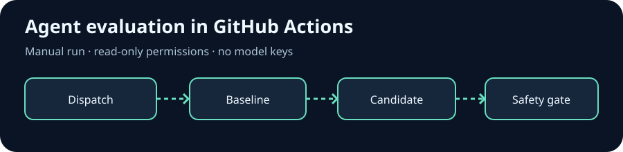

# @metaharness/host-github-actions

Run a repeatable agent policy evaluation in GitHub Actions. This MetaHarness host adapter scaffolds a workflow and composite action; the opt-in recipe below compares a baseline with a candidate on labeled cases and fails when the candidate regresses or permits an unsafe action.

[](https://github.com/ruvnet/metaharness/tree/main/packages/host-github-actions)

[Ruvnet](https://ruv.io) · [MetaHarness](https://github.com/ruvnet/metaharness)

## Quickstart: evaluate an agent policy in CI

Requires Node.js 20 or newer, npm, Git, and a POSIX shell for setup. The generated job runs on an Ubuntu GitHub Actions runner with Node.js 22. It uses a deterministic example, requires no model keys, and does not send anything to a model.

From a checkout of this repository, run the following in a fresh temporary project:

```sh
work=$(mktemp -d)
cp packages/host-github-actions/examples/scaffold-evaluation.mjs "$work/"
cd "$work"
npm init -y
npm install --ignore-scripts --save-exact @metaharness/host-github-actions@0.1.4
node scaffold-evaluation.mjs
node .github/actions/agent-evaluation/evaluate.mjs
```

Expected evaluator output:

```json
{"cases":5,"baselineCorrect":2,"candidateCorrect":5,"unsafeAllows":0,"pass":true}
```

Commit the generated `.github` files to your default branch, then select **Actions → Agent evaluation → Run workflow**. This evaluation recipe is manual, uses a read-only token with credentials persistence disabled, and has a five minute timeout. Replace the sample policies and labeled cases with your own versioned fixtures before using it to evaluate a real harness. The sample score demonstrates the gate and does not measure a real model.

To use the full generator after the fixture passes, see the [MetaHarness user guide](https://github.com/ruvnet/metaharness/blob/main/docs/USERGUIDE.md).

## General purpose scaffolding (ADR-033)

The original host scaffolds a generic autonomous harness. Its composite action contains placeholder output: it does not evaluate a candidate or run an agent until you wire in an entrypoint. Review triggers and permissions before connecting model credentials. In public repos, do not expose a secret-bearing job to untrusted issue comments.

## What it emits

`adapter.generateConfig(spec)` returns:

| File | Purpose |
|---|---|
| `.github/workflows/<name>.yml` | the trigger workflow (default: manual dispatch + issue-comment) |
| `.github/actions/<name>/action.yml` | a reusable composite action the workflow calls |
| `install.md` | wiring + permissions runbook |

## Default-deny → least-privilege token

ADR-022's default-deny posture is preserved, but enforcement shifts from the
in-process `mcp-policy.json` gate to the workflow's own `permissions:` block.
The adapter starts from `contents: read` and grants **only** the scopes the
harness policy's allow-list implies:

| allow token (regex) | GitHub scope granted |
|---|---|
| `create-pr`, `push-branch`, `pull-request` | `contents: write`, `pull-requests: write` |
| `issue`, `label`, `triage` | `issues: write` |
| `checks`, `status` | `checks: write` |

Anything unmapped stays denied (omitted). For production-touching jobs, gate
behind a GitHub Environment with required reviewers — the `permissions:` block
scopes the token; the Environment adds the human review it cannot.

## Usage

```ts
import adapter from '@metaharness/host-github-actions';

const files = adapter.generateConfig({
  name: 'release-bot',
  description: 'cuts releases on tag push',
  permissions: { allow: ['create-pr', 'label-issue'] },
});
// → { '.github/workflows/release-bot.yml', '.github/actions/release-bot/action.yml', 'install.md' }
```

Or scaffold a full harness:

```bash
npx metaharness my-bot --template minimal --host github-actions
```

## License

MIT.
