# @metaharness/host-hermes

<!-- ruv-seo:start (ADR-356) -->


Turns a MetaHarness harness spec into a Hermes Agent (Nous Research) `cli-config.yaml` plus optional MCP server files, and exports `scrubHermesBlocks()` to strip `<think>` and `<tool_call>` blocks from Hermes output.

**Supported environments:** Node.js 20+ on Linux, macOS and Windows. ESM only (`import`, not `require`). Pure JavaScript with no native build step; `@metaharness/kernel` is used only for its `HarnessSpec` and `HostAdapter` types.

## Quickstart

```bash
npm install @metaharness/host-hermes
```

Save this as `quickstart.mjs` and run `node quickstart.mjs`:

```js
import adapter from '@metaharness/host-hermes';

const files = adapter.generateConfig({
  name: 'my-bot',
  description: 'demo harness',
  mcpServers: [{ name: 'my-bot', command: ['node', './bin/mcp.js'] }],
});
console.log(`host: ${adapter.name}`);
for (const [path, body] of Object.entries(files)) {
  console.log(`${path}  (${body.split('\n').length} lines)`);
}
```

Expected output:

```text
host: hermes
cli-config.yaml  (9 lines)
optional-mcps/my-bot.yaml  (5 lines)
```

**Next:** [`@metaharness/hermes`](https://www.npmjs.com/package/@metaharness/hermes) — scaffold a complete, doctor-checked harness for this host in one command (`npx @metaharness/hermes my-bot`).

**Where it fits:** `npx metaharness new <name> --host hermes` adds this package as a dependency of the generated harness, and the generated `__tests__/smoke.test.ts` imports it, so `npm test` in that harness fails if the adapter is missing or broken.
<!-- ruv-seo:end -->

## Reference

[Hermes Agent (NousResearch)](https://hermes-agent.nousresearch.com/docs/) host adapter for the [agent-harness-generator](https://github.com/ruvnet/agent-harness-generator) project.

Generates the host-specific files a Hermes-targeted harness needs:

- `cli-config.yaml` with the system prompt and scrubbing flags
- `optional-mcps/*.yaml` per MCP server
- `scrubHermesBlocks()` helper exported for runtime use

## Hermes-4 quirk (mandatory handling)

Hermes-4 models emit `<think>...</think>` reasoning blocks AND occasionally raw `<tool_call>` text instead of using the OpenAI-compatible function-calling channel. See [hermes-agent#741](https://github.com/NousResearch/hermes-agent/issues/741).

**This adapter scrubs both** — same pattern as ruflo's `scrubReasoningBlocks`. The `cli-config.yaml` sets both flags:

```yaml
scrub_think_blocks: true
scrub_stray_tool_calls: true
```

## Two distinct Hermes projects — do not conflate

| Project | What it is |
|---|---|
| [NousResearch/Hermes-Function-Calling](https://github.com/NousResearch/Hermes-Function-Calling) | OLDER function-calling reference for Hermes 2/3 |
| [NousResearch/hermes-agent](https://github.com/NousResearch/hermes-agent) | CURRENT long-running agent runtime with MCP support |

This adapter targets the **current** runtime.

## Usage

```js
import adapter, { scrubHermesBlocks } from '@metaharness/host-hermes';

const config = adapter.generateConfig({
  name: 'my-bot',
  systemPrompt: 'You are a helpful agent.',
  mcpServers: [{ name: 'my-bot', command: ['npx', '-y', 'my-bot', 'mcp'] }],
});
// config['cli-config.yaml'] = '<YAML>'
// config['optional-mcps/my-bot.yaml'] = '<YAML>'

// At runtime:
const safe = scrubHermesBlocks(modelResponse);
```

## License

MIT
