# @metaharness/host-prime-agent

<!-- ruv-seo:start (ADR-356) -->


Turns a MetaHarness harness spec into project-scoped Prime Agent (PrimeIntellect) skills under `.prime/agent/`: instruction-only skills for tools, Python-backed skills for remote HTTP MCP servers, and an install runbook.

**Supported environments:** Node.js 20+ on Linux, macOS and Windows. ESM only (`import`, not `require`). Pure JavaScript with no native build step; `@metaharness/kernel` is used only for its `HarnessSpec` and `HostAdapter` types.

## Quickstart

```bash
npm install @metaharness/host-prime-agent
```

Save this as `quickstart.mjs` and run `node quickstart.mjs`:

```js
import adapter from '@metaharness/host-prime-agent';

const files = adapter.generateConfig({
  name: 'my-bot',
  description: 'demo harness',
  tools: [{ name: 'search-docs', description: 'Search the project docs' }],
  mcpServers: [{ name: 'docs', url: 'https://example.com/mcp' }],
});
console.log(`host: ${adapter.name}`);
for (const [path, body] of Object.entries(files)) {
  console.log(`${path}  (${body.split('\n').length} lines)`);
}
```

Expected output:

```text
host: prime-agent
.prime/agent/skills/search-docs/SKILL.md  (21 lines)
.prime/agent/settings.json  (10 lines)
.prime/agent/skills/mcp-docs/SKILL.md  (19 lines)
.prime/agent/skills/mcp-docs/pyproject.toml  (14 lines)
.prime/agent/skills/mcp-docs/src/mcp_docs/__init__.py  (16 lines)
install-prime-agent.md  (35 lines)
```

**Next:** [`metaharness`](https://www.npmjs.com/package/metaharness) — scaffold a complete harness for this host with `npx metaharness new my-bot --host prime-agent`.

**Where it fits:** `npx metaharness new <name> --host prime-agent` adds this package as a dependency of the generated harness, and the generated `__tests__/smoke.test.ts` imports it, so `npm test` in that harness fails if the adapter is missing or broken.
<!-- ruv-seo:end -->

## Reference

Prime Agent ([PrimeIntellect-ai/prime-agent](https://github.com/PrimeIntellect-ai/prime-agent))
host adapter — the 11th harness host, per
[ADR-247](../../docs/adrs/ADR-247-host-prime-agent.md).

## What it emits

Integration lands as project-scoped skills under `.prime/agent/skills/`:

- `spec.tools[]` → instruction-only `SKILL.md` contracts. `ToolSpec` does not
  contain an executable handler, so the adapter never fabricates one.
- Remote HTTP `spec.mcpServers[]` → `.prime/agent/settings.json` plus real
  Python-backed `rlm.McpIntegration` skill packages. Local stdio MCP remains
  explicitly unsupported by Prime Agent's current kernel integration.
- `spec.systemPrompt` → `.prime/agent/APPEND_SYSTEM.md`
- `spec.agents[]` → skills that delegate through Prime Agent's native `rlm`
  recursive-agent callable
- Always: `install-prime-agent.md` (install runbook, skill precedence notes,
  MCP availability, and the ADR-246 autonomous invocation snippet when present)

## Sandbox caveat

**Prime Agent is not sandboxed.** It executes model-written Python at user
permission level with no native allow/deny enforcement. When
`spec.permissions.deny` is non-empty, this adapter fails closed: it emits a
prominent `SANDBOX-REQUIRED.md` (and the same warning at the top of
`install-prime-agent.md`) enumerating the denied capabilities that require an
external sandbox (container, RVM per ADR-018, or equivalent). The deny-list is
never silently dropped (ADR-247 §2.2).
