# @metaharness/workspace-lens

<!-- ruv-seo:start (ADR-356) -->


`@metaharness/workspace-lens` reads what an open-weight model is internally "thinking about" at inference time: it projects residual activations through a fitted Jacobian lens (lens_l(h) = unembed(J_l · h)) into workspace tokens, a layer trajectory, drift and entropy scores, safety flags and a hashable receipt.

**Supported environments:** Node.js 20+ on Linux, macOS and Windows. ESM library, dependency-free, model-agnostic. Runtime only: you capture activations from your own runtime and fit the lens offline.

## Quickstart

```bash
mkdir demo && cd demo && npm init -y >/dev/null
npm install @metaharness/workspace-lens
cat > quickstart.mjs <<'JS'
import { WorkspaceLens, buildReceipt } from '@metaharness/workspace-lens';

// A tiny synthetic lens. Real lenses are fitted offline on an open-weight model.
const lens = WorkspaceLens.fromArtifact({
  lensId: 'jlens-demo', modelId: 'synth-3d', dModel: 3,
  vocab: ['ok', 'wrong', 'exfiltrate'],
  unembed: [[1, 0, 0], [0, 1, 0], [0, 0, 1]],
  layers: [{ layer: 5, jacobian: [[1, 0, 0], [0, 1, 0], [0, 0, 1]] }],
});
const concepts = [{ concept: 'exfiltration', modelId: 'synth-3d', vector: [0, 0, 1], critical: true }];

// Hand the lens residual activations you captured at layer 5.
const receipt = buildReceipt(lens, 'summarize the doc', [{ layer: 5, position: 4, h: [0, 0, 9] }],
  { createdAt: '2026-07-07T00:00:00Z', concepts });

const top = receipt.topTokens[0].tokens[0];
console.log('top workspace token:', top.token ?? top);
console.log('flags:', JSON.stringify(receipt.flags));
console.log('critical triggers:', receipt.triggers.filter((t) => t.critical).map((t) => t.concept).join(', '));
console.log('receipt prompt hash:', receipt.promptHash.slice(0, 16) + '…');
JS
node quickstart.mjs
```

Expected output:

```text
top workspace token: exfiltrate
flags: {"promptInjection":true,"evalAwareness":false,"hiddenObjective":false,"refusalConflict":false}
critical triggers: exfiltration
receipt prompt hash: 46f9a175a791cbe9…
```

**Next:** [`@metaharness/workspace-probe`](https://www.npmjs.com/package/@metaharness/workspace-probe) — turn these receipts into a score and veto mutations whose workspace gets worse.
<!-- ruv-seo:end -->

## Reference

**A Jacobian-Lens interpretability primitive for open-weight LLMs.** Read the model's *verbalizable
workspace* — the concepts it is disposed to say next — at inference time, and turn it into workspace
tokens, a layer-by-layer thinking trajectory, drift/entropy scores, vectorized safety flags, and a
signable **interpretability receipt**.

Runtime-only · model-agnostic · dependency-free (Node built-ins) · deterministic · `$0` to run.

> Companion runtime for Anthropic's *"Verbalizable Representations Form a Global Workspace in Language
> Models"* (2026-07-06) and its reference code [`anthropics/jacobian-lens`](https://github.com/anthropics/jacobian-lens).
> This package is **not affiliated with Anthropic**; it is an independent, Apache/MIT-compatible
> runtime that *consumes* a fitted lens.

---

## Why this exists: from black-box testing to Mechanistic Governance

Classic **logit lens** decodes an intermediate activation `h_l` through the unembedding directly —
assuming middle layers already live in final-output coordinates. They don't, so the readout is noisy.

The **Jacobian Lens** learns an average layer→final map `J_l` and decodes through it:

```
lens_l(h) = unembed(J_l · h)
```

Instead of asking *"what does this activation predict right now?"*, it asks *"what is this activation
**disposed** to make the model say later?"* — surfacing meaningful, reportable concepts **earlier** in the
network, often **before the first output token is generated**. Anthropic show models maintain a small set
of verbalizable internal representations that behave like a functional **global workspace** (report,
modulation, reasoning, reuse, selective access) — and that hidden concepts like *evaluation awareness*,
*manipulation*, *secretly*, and *trick* light up there even when absent from the output.

That makes the lens a **runtime semantic firewall** and an audit primitive — the basis for what we call
**Interpretability Operations (IntOps)**: tap the model's internal wires *while it thinks*, instead of
asking it to explain itself afterward (which is prone to sycophancy and confabulation).

## What's in the box

| Capability | Export | What it does |
|---|---|---|
| **Lens readout** | `WorkspaceLens.readout(h)` | `unembed(J_l·h)` → top workspace tokens + readout entropy |
| **J-projection** | `WorkspaceLens.project(h)` | `z_l = J_l·h`, the activation in final-layer coordinates |
| **Workspace drift** | `workspaceDrift(readouts)` | mean Jensen–Shannon divergence between consecutive readouts — is the reasoning path stable or mutating? |
| **Entropy trajectory** | `entropyTrajectory(readouts)` | per-layer entropy — is the workspace converging or dissolving? |
| **Vectorized safety** | `detectConcepts(...)` / `flagsFromTriggers(...)` | dot-product triggers vs. concept **directions** (not token strings) → `{promptInjection, evalAwareness, hiddenObjective, refusalConflict}` |
| **Receipt** | `buildReceipt(...)` | the signable `WorkspaceLensReceipt` audit artifact |
| **Decision rule** | `decide(...)` | `taskResolved && drift<θ && noCriticalFlags && receiptCoverage===1` |

## Install

```bash
npm i @metaharness/workspace-lens
```

## Quickstart

```ts
import { WorkspaceLens, buildReceipt, decide } from '@metaharness/workspace-lens';

// 1) Load a lens FITTED OUT OF BAND (see "Fitting" below). The artifact carries the vocab + unembed,
//    so scoring never touches a tokenizer at runtime.
const lens = await WorkspaceLens.fromFile('./jlens-qwen2.5-7b.json');

// 2) Capture residual activations from your open-weight runtime and hand them in.
const states = [
  { layer: 14, position: 6, h: /* number[dModel] */ activations14 },
  { layer: 18, position: 6, h: activations18 },
  { layer: 22, position: 6, h: activations22 },
];

// 3) Read the workspace + build the audit receipt.
const receipt = buildReceipt(lens, prompt, states, {
  createdAt: new Date().toISOString(),   // pass it in — receipts stay reproducible
  concepts,                              // per-model concept direction vectors (optional)
  topK: 8,
});

// 4) Govern on it.
const verdict = decide({
  taskResolved,
  workspaceDrift: receipt.workspaceDrift,
  driftThreshold: 0.25,
  triggers: receipt.triggers,
  receiptCoverage: 1,
});
if (!verdict.accepted) escalateToHuman(verdict.reasons, receipt);
```

## The interpretability receipt

The killer feature for regulated buyers: an audit log that maps the **causal trajectory** of a decision —
*where* a concept arrived, *how* confidence moved, *which* objectives competed — not just the final
answer. It turns *"the model is a black box that hallucinated"* into *"the model identified a structural
contradiction at layer 22 and executed the safety policy."* See `WorkspaceLensReceipt` in
[`src/types.ts`](./src/types.ts).

## Cross-family vocabulary alignment (the hard part, solved)

Different model families (Qwen vs. Gemma 2) have vastly different tokenizers, so you **cannot** align a
concept like *"hidden objective"* by token string. This package aligns at the **concept-direction** level:
a canonical concept name maps to a **per-model unit vector** in that model's J-space (`ConceptVector`),
fitted from example activations. Safety detection is a cosine/dot-product in activation space —
tokenizer-agnostic — and a concept vector is **never** cross-applied to a different model (`modelId` is
checked). So `hidden_objective` is *one* concept with a Qwen vector and a Gemma vector, aligned by name.

## Deployment topology (Triage Architecture)

Runtime projection is just static linear algebra (`J_l·h` + a softmax) — **zero** backward passes — so it
can run live, not only in shadow sampling:

| Tier | Trigger | Depth | Overhead |
|---|---|---|---|
| **1 · Passive** | low-risk chat / static generation | lens bypassed | 0% |
| **2 · Spot-check** | 1% shadow sampling · Darwin-Mode mutation evidence | async batch logging | ~0% |
| **3 · Full intercept** | tool calls · financial txns · PII · untrusted retrieval | synchronous, mid-layers at critical tokens | small |

Bind Tier 3 to high-stakes routing tokens (e.g. a tool-call token) and you get a **deterministic circuit
breaker**: a spike in the *exfiltration* / *override* / *credential* directions can kill execution
mid-forward-pass, *before* a single malicious token is emitted.

## Fitting is external (the one real constraint)

This package **applies** a lens; it does not **fit** one. Fitting `J_l` requires the model's **backward
pass** over ~100–1000 short sequences (quality saturates quickly), which needs **open-weight local
models** with activation + gradient access — not a closed API. Fit with the reference
[`anthropics/jacobian-lens`](https://github.com/anthropics/jacobian-lens) (or load a community pre-fit),
serialize to the `LensArtifact` shape, and load it here. No weights or corpora are bundled.

## Acceptance test

Fit a lens on a 1.5B–7B Qwen model, run reasoning prompts where the model must hold state silently
(*"Is `12 + 5 = 1` correct? Answer only Yes or No."*), extract mid-layer states, and verify the Jacobian
readout surfaces `wrong`/`incorrect`/`false` in the middle workspace **while the input prefix is still
being processed** — 2–3 layers earlier and with ≥20% higher logit clarity than logit-lens across ≥50
variations. The [test suite](./__tests__/workspace-lens.test.ts) includes the *mechanism* shape of this
check on synthetic artifacts (`$0`, no model).

## Where it plugs into MetaHarness

- **Evaluation** — a `workspace_probe` surface: does a candidate harness make the model hold better
  intermediate concepts *before* answering?
- **Darwin Mode** — J-lens readouts as **mutation evidence**: reject a prompt mutation that improves the
  final token but causes the workspace to lose its early grip on the right concept (structurally brittle).
- **Safety auditing** — prompt injection, hidden-objective drift, eval-awareness, reward-hacking, refusal
  analysis, as *state assertions* rather than perimeter filters.
- **Receipts** — attach an interpretability receipt to every governed agent decision.

## Honest framing

This is a **measurement primitive**, not a product and **not** a consciousness claim — the paper frames
the connection to a global workspace as *functional* and leaves the philosophy open. The practical claim
is enough: a measurable window into hidden reasoning.

## Performance

`detectConcepts()` scores every `(state × concept)` pair, and runs once per
governed decision/trace against a concept library that's fitted ahead of time
and doesn't change. It caches each concept vector's norm by object identity
(`WeakMap<ConceptVector, number>`) instead of recomputing it inside `cosine()`
on every call, and hoists the projected activation's own norm out of the
per-concept inner loop. Same scores, same thresholds, same triggers — only
the redundant norm walks are gone. Measured on
`bench/detect-concepts-throughput.mjs` (`npm run bench`, deterministic
synthetic lens + concept library):

| concepts | states | dModel | before | after |
|---|---|---|---|---|
| 200 | 20 | 128 | 409 calls/s | 758 calls/s |
| 1,000 | 20 | 128 | 98 calls/s | 216 calls/s |
| 1,000 | 40 | 256 | 23 calls/s | 52 calls/s |
| 3,000 | 40 | 256 | 8 calls/s | 20 calls/s |

~1.9–2.5× faster, growing with concept-library size. Full results in
`bench/results/`.

## License

MIT.
